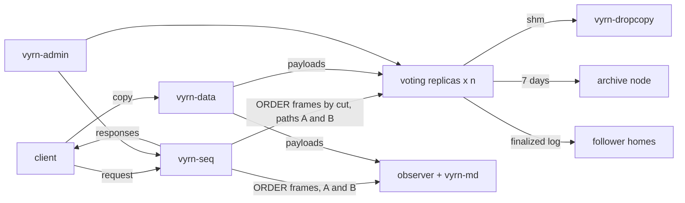
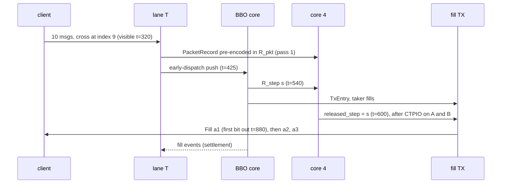

# 03. Architecture: how the pieces fit

Draft 0.2, 2026-11-13. Names, types, constants, layouts and invariants come from
[`01-conventions.md`](01-conventions.md), and its §14 overrides anything here. Names that are new
here have the prefix `ARC_` and are listed in **Local definitions**.

This chapter places every process on a box, every box in a facility, and every facility in a home.
It draws the data flows and the message sequences, with a time budget on each arrow. It does not
specify algorithms (`05-engine.md`), wire semantics (`04-protocol.md`), frames and consensus
(`07-replication.md`), epochs (`08-epochs.md`), chain mode (`09-chain.md`) or the host platform
(`06-platform.md`). It cites them.

Every number is a **budget** unless it is marked *vendor*. Draft 0.2 has no *measured* numbers.
"Peak" means one book at 1B msgs/s, 100M packets/s, 1% crosses (10M/s) and 2% improves or
depletions (20M/s), as in `DESIGN.md` §3.

The latency bound is a **maximum** for every accepted packet, every message type and every
message index 0–9 (`LAT_MAX_NS`, 01 §14.0). Every path below is budgeted at message index 9, the
worst case, and deadline admission (§6.0) answers `BUSY` to a packet that would miss it.

## 0. Decisions this chapter makes

These decisions are architecture. Each one is used by the diagrams below. Decisions that change a
statement in 01 are also listed in **Requests to 01**.

| ID | Decision | Reason |
|---|---|---|
| ARC-D1 | `vyrn-seq` **never votes** (01 §14.4). `N_BASE` and `N_CHAIN` count voting replicas only. BASE: F1 holds `vyrn-seq` and voting replica R1, and F2–F4 hold one voting replica each (2 Rust, 2 Vx). CHAIN: the 5 validator boxes vote (3 Rust, 2 Vx), and the sequencing operator votes from its validator box. | The sequencer's cores are all committed to the book. The set of voters, and so the client split, does not change when the sequencer fails. |
| ARC-D2 | Each home keeps a warm standby `vyrn-seq` (Rust) in F2. Failover promotes the standby, **never a voting replica**. | Promoting a replica would remove a voter and could hand one client a quorum. With n = 4 and Q = 3 it would also leave no fault tolerance during the failover. |
| ARC-D3 | Lanes **pre-encode** their `PacketRecord`s into a per-lane order ring (`R_pkt[l]`, 07 §4.1) at the start of pass 1, before the first push to the BBO core and before any counter release. The **stream cores** (stream-A core 4 for lanes 0–24, stream-B core 7 for lanes 25–48, 01 §14.15) drain their lanes up to each step's cut, append the `StepRecord`, and write the frames to both replication ports (01 §14.5). Lanes post nothing to a NIC for replication. | A fill depends on every op in its step's cut, not only on the `StepRecord`. Draining by cut on two cores, each with a fixed half, keeps one frame order per half and 49 doorbells per frame off the lanes. Pre-encoding early keeps the gate normally open. |
| ARC-D4 | After a stream core has written a frame to both ports, it publishes the **frame gate** `released_step` (07 §4.2). **Every** response is gated, including acks and `BUSY`: no core writes a response that depends on step s, or on an op in s's cut, before `released_step ≥ s`. | `INV-FRAME-FIRST` then holds for every response from every core (01 §14.5), so an acked order is never lost when the sequencer crashes. |
| ARC-D5 | The stream core of lane l's half writes `LaneCut[l] = (s, cut_s[l])` (05 §4.15) only **after** it has released s. A lane sends `Ack`/`CancelAck`/`BUSY` for an op only after `LaneCut[l]` covers the op, and after it has drained its fill ring through step s − 1. | A step in flight with an older cut can still fill the order. Writing `LaneCut` after the release makes the ack's gate check (10 ns) always pass, so the ack path has a hard bound: 965 ns worst at index 9 with the 170 ns cut term and the 20 ns poll (01 §14.17.1). |
| ARC-D6 | Every outcome that depends on the BBO snapshot is a BBO-core decision. Lanes route IOC, FOK, and any post-only order that would cross the lane's snapshot to the BBO core. A lane-local decision depends only on lane state. | The snapshot version that a lane read is not in the order stream. If a lane made such a decision, a replica could not replay it (`INV-DET`). |
| ARC-D7 | The TX cores (TX-A c3, TX-B c5, TX-C c0; 01 §14.17.3) send the response to every order op that a lane routed to the BBO core and that the BBO core executed (a depletion hint has no response), and every **maker fill** and maker `Out STP` of the step, from the maker's reserved credit (01 §14.14). The lane reserves the taker's `resp_seq` when it routes the op. For a routed op that the BBO core sheds (`StepKind::Shed`), the lane writes `BUSY` into the reserved slot (01 §14.1). The lane sends every other response: `Ack`, `CancelAck`, `Reject`, `BUSY`, fills from rescans, and resends. | Each `resp_seq` has one writer, chosen by logged data (`INV-WRITER`, `INV-DET`), and taker and maker fills both skip a BBO → lane hop (~100 ns). |
| ARC-D8 | REF `vyrn-seq` has 6 × X2541: 4 client-facing and 2 replication ports (`RNA`, `RNB`) on two different leaf switches. That is 96 PCIe lanes (01 §14.7). | At peak, the 4 client ports run at ~50% each way (DESIGN §4). `REPL_PATHS = 2` needs two ports, each on its own switch. A shared port would put both paths in one failure domain. |
| ARC-D9 | An unplanned loss of a lane core is a box failure, and it starts a sequencer failover. The spare cores 52–55 and 63 are used only for planned evacuation, at an epoch boundary or during a halt. | Linux cannot prove that a lost core stopped on an op boundary. A half-applied op that a spare core adopts breaks `INV-DET`. |
| ARC-D10 | The **replication unit** is one hot book, or one book group (§5). Each unit has one order stream, one block chain and one set of boxes. | Books in a group share lanes and `LaneSeq` numbers, so they cannot be replayed apart. |
| ARC-D11 | There is no automatic failover from one home to another. | A follower home cannot know the active home's finalized tip, so an automatic takeover could fork finality. `08-epochs.md` owns the manual procedure. |
| ARC-D12 | Each session has a **data home**, a `vyrn-data` box that is **never in the sequencer's facility** (01 §14.16, 07): the client's nearest facility among F2–Fn, balanced by rate. `vyrn-data` runs on dedicated boxes. The F1 data box is a backup home only. | The data tier handles ~187 Gbps per hot book. Losing F1 must not lose both copies of a packet. A failure of a data box does not remove a voter or the sequencer. |
| ARC-D13 | A lane processes a packet in **two passes** with early dispatch and the in-packet dependency list (01 §14.2), and admits it only if it can meet `LAT_MAX_NS` (deadline admission, 01 §14.1). The BBO core applies the same test and sheds with `StepKind::Shed` (§6.0). | This is what makes 1 µs a maximum at every message index instead of a percentile. |
| ARC-D14 | A sweep never holds the BBO core past its step budget. The BBO core ends a cross step at a segment boundary once the step has used `ARC_STEP_BUDGET_NS` (= `BBO_CROSS_NS` = 15) or written `STEP_FILL_CAP` = 64 fill records (01 §14.15), and continues the same taker in **continuation steps** with no other op in between. Each continuation step's fills leave as their own response packets. Maker fills of the first steps leave ≤ `LAT_MAX_NS` after the taker packet's first bit; those of later continuation steps ≤ `LAT_MAX_NS` after their own step starts (01 §14.17.5). | The taker's first response leaves within budget at any sweep depth, so no sweep depth is exempt from `LAT_MAX_NS`. A step's maker records never exceed one maker's 16-number credit. Price-time order is unchanged, because nothing interleaves with the taker. |
| ARC-D15 | `vyrn-md` runs on a non-voting **observer** replica box, one per facility per unit (10, 01 §14.11). The **recovery service** for resends runs on R2 (01 §14.6). | Voting replicas keep their cores for replay and votes. R2 sits in F2, so losing F1 does not lose both the sequencer's hot ring and the recovery service. |
| ARC-D16 | **Two lane classes** (01 §14.15): 42 **dedicated** lanes (cores 8–49), each serving the accounts of one firm, and a **pool** of 7 cores (56–62, CCD 7) that serves every other client (§4.2a). The lane map publishes each account's class. | A paced dedicated client never waits in the lane stage; small clients share 7 cores as one M/M/7 queue instead of 49 single servers (02 §4.4). |

## 1. Context and containers

### 1.1 Context diagram

```
                               ┌─────────────────────────────────────────┐
  trading clients ── pkt ×2 ──►│                                         │──► fills, acks, rejects
  (colo racks, cloud on-ramp)  │                                         │    (UDP, per session)
                               │                VYRN                     │
  market-data subscribers ◄────┤   one CLOB per instrument, 3 homes,     │
  (multicast in colo, unicast) │   n facilities per home                 │
                               │                                         │
  back offices ◄── drop copy ──┤                                         │◄── GPS antenna per facility
  (TCP, final fills only)      │                                         │    (PTP grandmaster)
                               │                                         │
  exchange operators ─────────►│  vyrn-admin: config, schedule, halts    │
  5 validator operators (CHAIN)│                                         │
                               │                                         │
  external chain ◄────────────►│  bridge, 4-of-5 threshold (CHAIN only)  │
  (deposits / withdrawals)     │                                         │
                               │                                         │
  auditors, regulators ◄───────┤  log archive, certificates, state roots │
                               └─────────────────────────────────────────┘
```

| Actor | Sends | Receives | Transport | Owner chapter |
|---|---|---|---|---|
| Trading client | request packets (01 §6.1): one copy to `vyrn-seq`, one to `vyrn-data` | response packets (01 §6.3) | UDP over a cross-connect or a cloud on-ramp | 04 |
| Market-data subscriber | subscriptions, recovery requests | the book feed, built on a replica | UDP multicast (bare metal), UDP unicast (AWS) | 10 |
| Back office | drop-copy login | final fills, tagged with `(StepId, ordinal)` | TCP | 10 |
| Exchange operator | config, schedule, halts, lane map | metrics, alerts | `vyrn-admin` on the control VLAN, OOB network | 11 |
| Validator operator (CHAIN) | its own nodes' config and keys | its own nodes' metrics | the same, one tenant per operator | 09 |
| External chain | deposit events | withdrawal transactions with 4-of-5 threshold signatures | each validator runs its own full node of that chain | 09 |
| GPS / PTP | time | — | GPS → grandmaster → PTP boundary clocks | 06 |
| Auditor | — | log archive, certificates, state roots, `K_com` disclosures | object storage export | 07, 09 |

### 1.2 Container diagram

```
 client ─(1) request ───────────────────────────────►┌───────────────── vyrn-seq────────────────┐
   │                                                 │ 42 dedicated lanes · pool of 7 · 2 cuts  │
   │◄──── responses (lanes, fill TX), all gated ─────┤ BBO · TX A/B/C · stream A/B · hash · ctl │
   │                                                 └──┬──────────────────────────────┬────────┘
   │                              ORDER frames (lane    │ HASH, HEADER frames (A, B)   │ session
   │                              records + StepRecords │                              │ install
   │                              by cut), A and B      ▼                              │ ▲
   └─(2) same request ──►┌─ vyrn-data ─┐     ┌── voting replicas × n (vyrn-replica │ vyrn-validator) ────┐
                         │ ingest      ├────►│ replay lanes · replay BBO (the same vyrn-engine)          │
                         │ fan-out     │ pay-│ Simplex (vyrn-consensus) · log store · hash chain         │
                         │ retain 5 s  │ load│ state root (CHAIN) · peer-fetch · recovery svc (R2)       │
                         └─────▲─────┘     └───┬───────────────┬───────────────┬─────────────────┬─┘
                               └─── fetch ─────┘               │ shm rings     │ certificates    │
                                     (miss)                    ▼               ▼                 │
                                  ┌─ observer + vyrn-md ─┐ ┌─ vyrn-dropcopy ─┐ follower homes ◄──────┘
                                  │ ORDER frames (F4)    │ │ final fills     │ (finalized log, WAN)
                                  │ + payloads (F7),     │ └──────┬──────────┘ ┌─ archive node ─┐
                                  │ no votes; feed A/B   │        │            │ 7 days, per    │
                                  └────┬─────────────────┘        ▼            │                │
                                       ▼                   back offices        │ facility       │
                                  subscribers                                  └────────────────┘

 vyrn-admin─ epoch config, lane map, session gateway (BASE) ──► vyrn-seq control core, replicas
 vyrn-sim ── every container above in one process, on a simulated NIC, network and clock
 vyrn-bench─ load generators and capture analysis for B1–Bn (11-build.md)
 vyrn-vx-client─ the Vx replica in CLIENT_SPLIT_* facilities · vyrn-vx-oracle─ reference book (diff)
```

The same diagram in Mermaid, for renderers that support it:



### 1.3 Containers

| Container | Binary | Runs on | Responsibilities | Inputs | Outputs |
|---|---|---|---|---|---|
| Sequencer | `vyrn-seq` | REF (live) in F1, REF (warm standby) in F2. Never votes. | Admit by deadline, parse, MAC, risk, classify, match, respond. Publish cuts and snapshots. Frame the order stream by cut and gate every response on it. Close blocks and sign headers. Keep `RESP_HOT_RING_BYTES` of responses per lane. | request packets; control ops from `vyrn-admin`; final session opens (CHAIN) | response packets; ORDER, HASH and HEADER frames; retransmits |
| Replica | `vyrn-replica` | REF, one voter per facility | Replay the order stream with `vyrn-engine`. Check payloads against `pkt_hash`. Vote in Simplex. Store 12 h of log locally. Hash-chain blocks. Serve fetches. Feed `vyrn-dropcopy` and the archive node. On R2: the recovery service. | order stream (A, B); payloads from `vyrn-data`; votes | votes, certificates, the finalized log, shm rings, resends (R2) |
| Observer | `vyrn-replica` in observer mode, with `vyrn-md` | REF, one per facility per unit (10) | Replay without voting. Publish the A feed (sequencer's facility) or the B feed (next facility). | order stream (A, B); payloads (data tier, or passive taps in F1, 10) | the book feed |
| Archive | `vyrn-replica` in archive mode | storage node, one or more per facility (§9.4) | Keep 7 days of the finalized log; serve auditors and slow catch-up. | the finalized log from the facility's replica | log exports |
| Validator | `vyrn-validator` | REF, one per operator per home | A replica, plus: `K_com` MAC check, session-open and transfer transactions, state root, bridge, slashing evidence. | as for the replica, plus chain transactions | as for the replica, plus state roots and bridge signatures |
| Vx replica | `vyrn-vx-client` | REF, in the facilities that `CLIENT_SPLIT_*` gives to Vx | The second implementation of replay and voting. Neither client can reach quorum alone. | as for the replica | votes, its own state hash |
| Data tier | `vyrn-data` | data box (§4.6), at least one per facility | Receive the client copy, fan it out to every replica of the unit, keep 5 s of it for fetches, rate-limit by source address. | client copies | multicast (bare metal) or unicast (AWS) payloads; fetch replies |
| Market data | `vyrn-md` | observer box | Build the public book feed from the replayed engine. Every subscriber gets identical bytes. | observer shm rings | the feed (10) |
| Drop copy | `vyrn-dropcopy` | replica box, core 63 | Send final fills to back offices. It sends only fills that are final (`INV-QUORUM`). | replica shm rings, certificates | TCP drop copy |
| Admin | `vyrn-admin` | admin box per facility | Epoch config, lane map, schedule, halts. In BASE it is also the session gateway (TLS). | operator commands | control ops to `vyrn-seq` and replicas; config committed through consensus |
| Simulator | `vyrn-sim` | DEV, CI | Deterministic run of a whole home: every container, a simulated NIC, network and PTP time. | scenario files | logs, diffs against `vyrn-vx-oracle` |
| Bench | `vyrn-bench` | load boxes, capture boxes | Load generation and capture analysis for the benchmarks. | config | reports |

### 1.4 Data flows

Rates are at peak for one hot book. The path column names the switches of §3.

| # | Flow | From → to | Rate | Path | Port | Format |
|---|---|---|---|---|---|---|
| F1 | Request, sequencer copy | client → `vyrn-seq` lane l | 100M pkts/s, 187 Gbps | CA/CB | `ARC_SEQ_PORT_BASE + l` | 01 §6.1 |
| F2 | Request, data copy | client → its data home's `vyrn-data` (never in F1) | 100M pkts/s, 187 Gbps | CA/CB | `ARC_DATA_PORT_BASE + l` | 01 §6.1 (the same bytes) |
| F3 | Responses, all frame-gated | lane or TX core (A, B, C) → client | ~100M pkts/s, ~180 Gbps | CA/CB | the client's source port | 01 §6.3 |
| F4 | ORDER frames (lane records drained by cut, then the `StepRecord`) | stream cores 4 and 7 → every replica and observer, on A and B | ≤ 10M frames/s per path (07 §4.5) | RA, RB, metro A/B | `ARC_ORDER_PORT` | 07 |
| F5 | HASH frames | hasher c50, framed by the stream cores → the same | ~0.1M/s per path | RA, RB | `ARC_ORDER_PORT` | 07 |
| F6 | Block headers, heartbeats, retransmits | stream core A (c4) ↔ replicas | 1k headers/s, heartbeats every 100 µs | RA, RB | `ARC_CTRL_PORT` | `BlockHeader` (01 §6.6) |
| F7 | Payload fan-out | `vyrn-data` → every replica's and observer's lane l | 187 Gbps | DX, metro data | `ARC_DATA_PORT_BASE + l` | the request bytes |
| F8 | Votes, proposals, certificates | replica ↔ replica | ~10k msgs/s | VLAN 400 on RA and RB | Commonware p2p (07) | 07 |
| F9 | Fetch | replica ↔ peers, data box, `vyrn-seq` c51 | rare (misses) | DX | `ARC_FETCH_PORT` | 07 |
| F10 | Market data | observer `vyrn-md` → subscribers | conflated, 10 | CA/CB, VLAN 500 | `ARC_MD_PORT_BASE + ch` | 10 |
| F11 | Drop copy | `vyrn-dropcopy` → back offices | final fills | VLAN 600 | TCP | 10 |
| F12 | Finalized log | active R1 → follower R1 (BASE) or each operator's own nodes (CHAIN) | ≤ 200 Gbps per hot book per pair | WAN | 07 | 07 |
| F12a | Archive | each replica → its facility's archive node | ~21 Gbps at average load | DX | NVMe/TCP | 07 |
| F12b | Resends older than the hot ring | client → R2 recovery service | rare | CA/CB | `ARC_RECOVERY_PORT` | 04 |
| F13 | Control ops | `vyrn-admin` → `vyrn-seq` c51 → lanes | rare | VLAN 700 | TLS | `ControlRecord` (Request 8) |
| F14 | Time | GM → switches → NIC PHCs | PTP rate | VLAN 800 | PTP | IEEE 1588 |

F1 and F2 carry the same bytes. The `pkt_hash` in each `PacketRecord` binds them. A client that
sends two different versions of a packet is caught when a replica checks the hash, and its session
is killed (DESIGN §5).

## 2. Global deployment

### 2.1 Homes and the metro

```
                     ~35 ms one way                        ~110 ms one way
        NYC ◄──────────────────────────────► LDN ◄──────────────────────────────► TYO
         ▲   16:00–24:00 UTC active             08:00–16:00 UTC active   00:00–08:00 UTC active
         │                                                                         │
         └──────────────────────────── ~80 ms one way ─────────────────────────────┘

   Rotation: TYO ──8 h──► LDN ──8 h──► NYC ──8 h──► TYO     (EPOCH_BOUNDARIES_UTC, 01 §5)

   One home (metro):
        ┌─────┐   ≤ ARC_METRO_ONEWAY_US   ┌─────┐
        │ F1  │◄─────────────────────────►│ F2  │        full mesh of dark fibre,
        └──┬──┘╲                        ╱ └──┬──┘        3 independent fibre sets:
           │    ╲                      ╱     │           path A, path B, data
        ┌──┴──┐  ╲────────────────────╱   ┌──┴──┐
        │ F4  │◄─────────────────────────►│ F3  │        (+ F5 in CHAIN)
        └─────┘                           └─────┘
```

The WAN one-way budgets are `ARC_WAN_NYC_LDN_MS = 35`, `ARC_WAN_LDN_TYO_MS = 110` and
`ARC_WAN_NYC_TYO_MS = 80`. They are budgets for the provisioned routes. Light in fibre takes ~5 µs
per km (DESIGN §6), so a route that is longer than its budget allows is rejected when the WAN is
procured. The metro one-way budget is `ARC_METRO_ONEWAY_US = 500`, which includes switch hops and
receive processing (DESIGN §5).

### 2.2 Roles per facility

The table shows one replication unit. §9 multiplies it by the number of units.

**BASE (n = 4, one operator, `CLIENT_SPLIT_BASE` = 2 Rust, 2 Vx)**

| Facility | Active home | Follower home |
|---|---|---|
| F1 | `vyrn-seq` **live** (does not vote) · voting `vyrn-replica` R1 (Rust) with `vyrn-dropcopy` · observer with `vyrn-md` (A feed) · `vyrn-data` (backup data home only) · `vyrn-admin` · archive | `vyrn-seq` warm (live at the next epoch of this home) · R1 follows · observer idle · `vyrn-data` idle · `vyrn-admin` · archive |
| F2 | `vyrn-seq` **warm standby** (Rust) · voting `vyrn-replica` R2 (Rust) with `vyrn-dropcopy` and the recovery service · observer (B feed) · `vyrn-data` · `vyrn-admin` · archive | `vyrn-seq` warm · R2 follows · the rest idle · archive |
| F3 | voting `vyrn-vx-client` R3 · observer · `vyrn-data` · `vyrn-admin` · archive | R3 follows · the rest idle |
| F4 | voting `vyrn-vx-client` R4 · observer · `vyrn-data` · `vyrn-admin` · archive | R4 follows · the rest idle |

Voters: R1–R4, 2 Rust and 2 Vx, Q = 3. Neither client reaches Q alone, before or after a
failover, because failover promotes the standby `vyrn-seq` and never a replica (ARC-D2).

**CHAIN (n = 5, five operators, `CLIENT_SPLIT_CHAIN` = 3 Rust, 2 Vx)**

| Facility | Active home | Follower home |
|---|---|---|
| F1 | operator 1's `vyrn-validator` V1 (Rust) · observer with `vyrn-md` · the five operators' `vyrn-seq` boxes, of which the epoch's sequencer operator's box is **live** · `vyrn-data` (backup only) · archive | V1 follows · all `vyrn-seq` warm |
| F2 | V2 (Rust) · observer · the five operators' standby `vyrn-seq` boxes, of which the next operator's box is the **standby** · `vyrn-data` · archive | V2 follows · warm |
| F3 | V3 (Rust) · observer · `vyrn-data` · archive | V3 follows |
| F4 | V4 (`vyrn-vx-client`) · observer · `vyrn-data` · archive | V4 follows |
| F5 | V5 (`vyrn-vx-client`) · observer · `vyrn-data` · archive | V5 follows |

The 5 validator boxes are the voters, Q = 4. No `vyrn-seq` box votes. The sequencing operator votes
from its own validator box (09). Operator k runs its validator in Fk in every home, so one
operator is one facility in each home and one Byzantine fault (`F = 1`). The sequencer always sits in F1 and the standby always sits in F2, so
clients colocate in one place whichever operator is sequencing. Each operator therefore keeps one
`vyrn-seq` box in F1 and one in F2 of each home: 10 `vyrn-seq` boxes per unit per home, of which 2 take
traffic. §9 counts the cost, and Open question 12 names a cheaper option.

```
 BASE, one unit, around the boundary T between TYO (epoch e) and LDN (epoch e+1)

            TYO (active until T)                           LDN (follower until T)
 F1  [SEQ live] [R1 vote] [OBS md-A] [DAT] ── log ──►  F1  [SEQ warm] [R1 follows] [DAT idle]
 F2  [SBY warm] [R2 vote] [OBS md-B] [DAT]             F2  [SBY warm] [R2 follows] [DAT idle]
 F3  [R3 Vx vote] [OBS] [DAT]                          F3  [R3 Vx follows]
 F4  [R4 Vx vote] [OBS] [DAT]                          F4  [R4 Vx follows]
                     │ T: the sequencer stops at S, cert(HandoffRecord e, S)
                     ▼
            TYO (follower from T)                          LDN (active from S + 1)
 F1  [SEQ warm] [R1 follows] [DAT idle]  ◄── log ────  F1  [SEQ live] [R1 vote] [OBS md-A] [DAT]
 F2  [SBY warm] [R2 follows] [DAT idle]                F2  [SBY warm] [R2 vote] [OBS md-B] [DAT]
 F3  [R3 Vx follows]                                   F3  [R3 Vx vote] [OBS] [DAT]
 F4  [R4 Vx follows]                                   F4  [R4 Vx vote] [OBS] [DAT]

 SEQ and SBY never vote. NYC follows the whole time, and becomes active at the next boundary.
```

No box changes binary at a boundary. A role changes through configuration that the epoch config
already holds: a warm `vyrn-seq` goes live, a live one goes warm, and replicas switch between voting
and following. `08-epochs.md` owns the order of these switches.

"Warm" means that the box runs `vyrn-seq` in replay mode on the finalized log. A warm box holds the
book within `ARC_WARM_LAG_MS` of the finalized tip, and it can go live once it holds the final
prefix (§6.18). A follower replica replays the finalized log, stores it, and checks every
certificate. It does not vote in the active home's consensus.

### 2.3 WAN links

| Pair | One-way budget | Carriers | Capacity budget per hot book | Carries |
|---|---|---|---|---|
| NYC ↔ LDN | 35 ms | 2, on diverse routes | 2 × 3 × 100 Gbps | the finalized log (order + data), certificates, handoff records |
| LDN ↔ TYO | 110 ms | 2, on diverse routes | 2 × 3 × 100 Gbps | the same |
| NYC ↔ TYO | 80 ms | 2, on diverse routes | 2 × 3 × 100 Gbps | the same |

At peak the full log is ~208 Gbps per hot book (187 Gbps of data plus ~21 Gbps of order stream,
DESIGN §5 and §7). At the average load of 10% (DESIGN §7) it is ~21 Gbps. Each carrier is sized at
300 Gbps per hot book per pair, so **either carrier alone** carries the peak log with 30% headroom,
and a follower is never behind by more than one WAN one-way plus queueing. The 8 h move therefore
never waits for WAN capacity, even with one carrier down. `08-epochs.md` owns the readiness check
at T.

One sender per operator streams over the WAN. In BASE, R1 of the active home sends to R1 of each
follower home, and R2 is the backup sender. In CHAIN, each operator's active validator sends to its
own follower nodes, so no operator depends on another operator's WAN link. Follower replicas in
one metro share the log among themselves on the data fabric, so each WAN link carries the log
once. A follower trusts what it receives only through certificates (`INV-QUORUM`), so a single
sender is enough.

## 3. Facility network

### 3.1 Diagram (the active home's F1, one unit)

The diagram shows one data box, and draws the observer box on the same ports as R1 (it has its
own A, B, tap and publication ports, §4.10). A hot book at peak uses D = 2 per facility (§9.4), each serving half
the lanes and each with one port on CA and one on CB.

```
   client racks and cloud on-ramps: 2 cross-connects per client, one to CA and one to CB,
   cut to equal fibre length
        ║                                   ║
  ┌─────╨──────┐                      ┌─────╨──────┐
  │ CA client  │                      │ CB client  │      merchant-silicon leaves,
  │ leaf       │◄──────────────────┐  │ leaf       │      PTP boundary clocks
  └─┬───┬─────┬┘                   │  └─┬───┬──┬──┬┘
    │   │     └───────┐    ┌───────┼────┘   │  │  ▲   legs, left to right:
    │   │ ┌───────────┼────┼───────┼────────┘  │  │   CA: NIC0 NIC1 D-in
    │   │ │ ┌─────────┼────┼───────┼───────────┘  │   CB: D-in NIC2 NIC3 MD
    │   │ │ │         ▼D-in▼       │              │   MD-out comes from the observer
  ┌─┴───┴─┴─┴───┐  ┌──────────┐  ┌─┴──────────────┴┐
  │   vyrn-seq  │  │ vyrn-data│  │ R1 replica, and │
  │ live, 6 NICs│  └────┬─────┘  │ observer + md   │
  └──┬───────┬──┘       │ D-out  └┬──────┬──────┬──┘
    RNA     RNB         ▼         │A     │B     │D (×2)
     │       │   ┌────────────┐   │      │      │
     │       │   │ DX data    │◄──┼──────┼──────┘
     │       │   │ switch     │   │      │
     ▼       ▼   └─────┬──────┘   │      │
  ┌──────┐ ┌──────┐    ║          │      │
  │ RA   │ │ RB   │◄───╫──────────┘      │
  │ path │ │ path │◄───╫─────────────────┘
  │  A   │ │  B   │    ║
  └──┬───┘ └──┬───┘    ║
     ║        ║        ║  dark fibre to F2 … Fn: three separate fibre sets on separate routes
     ║ A      ║ B      ║ data
  ═══╩════════╩════════╩═══════════════════════════════════════════════════════════════

  ┌──────────────┐  PTP (L2 multicast, its own VLAN on each switch)
  │ GM (GPS)  ×2 ├──► CA · CB · RA · RB · DX ──► the PHC of every NIC
  └──────────────┘
  ┌──────────────┐  OOB: BMCs, serial consoles, PDUs, the switches' management ports, admin box.
  │ OOB switch   │  Its own carrier uplink. No production VLAN touches it.
  └──────────────┘
```

### 3.2 Switches

| Switch | Count per facility | Ports to | Rule |
|---|---|---|---|
| CA, CB (client leaves) | 2 | clients; `vyrn-seq` NIC0–1 (CA) and NIC2–3 (CB); `vyrn-data` ingest; observer `vyrn-md` output; R2 recovery service | Cut-through, a merchant ASIC, hardware PTP boundary clock. Client fibre lengths are equal. |
| RA, RB (replication) | 2 | `vyrn-seq` RNA (RA) and RNB (RB); each replica's and observer's A and B ports; metro fibre A or B | The two switches share no power feed, no fibre route, no line card and no software image version. |
| DX (data fabric) | 1 (2 when ≥ 2 data boxes) | `vyrn-data` output; each replica's and observer's two D ports; archive nodes; metro data fibre | Losing data is recoverable by fetch (§6.20), so a single switch is allowed. |
| OOB | 1 | management ports | No route to any production VLAN. |

**Only merchant-silicon switches.** A switch qualifies if its forwarding ASIC is a merchant part
sold to many switch vendors, and it runs no user logic. Excluded: any switch built on an FPGA. That
includes the Arista 7130 series (formerly Metamako) and the Cisco Nexus 3550-F series (formerly
Exablaze). Also excluded: any programmable pipeline used for our logic (P4/Tofino class).
`C-NOCHIP` forbids them. They are also unnecessary. Switch latency is outside the measured path,
because REQ-LAT-1 is measured from the exchange NIC (01 §5 `LAT_MAX_NS`). Fairness needs only
equal paths, not short ones.

### 3.3 Time

| Element | Rule | Budget |
|---|---|---|
| Grandmaster | 2 per facility, each with its own GPS antenna. The BMCA picks one. | `ARC_PTP_OFFSET_NS = 100`: maximum PHC offset from TAI over the B-ARC-1 run |
| Switches | Hardware boundary clock on every port that faces a host. | included in the 100 |
| NIC PHCs inside one box | Every NIC's PHC is disciplined from PTP, and each one is cross-checked against the others by the PTP daemon on core 0. | `ARC_PHC_SKEW_NS = 50`: maximum skew between any two NICs of one box over the B-ARC-1 run |
| Use | Only the NIC RX timestamp enters the order stream (01 §11.3). | — |

PHC skew between the 4 client NICs cannot break determinism, because the timestamps are logged and
replicas never read a clock. It can break fairness. A lane FIFO merge orders resting orders by
`(rx_ts, lane)`, so a skew of 50 ns between NIC0 and NIC2 moves priority by up to 50 ns between
their lanes. `ARC_PHC_SKEW_NS` bounds that error. Benchmark B-ARC-1 (Open question 4) measures it.

### 3.4 Addressing plan

| Item | Rule |
|---|---|
| IPv4 | `10.H.F.x`, where `H` is the `HomeCode` (1 = TYO, 2 = LDN, 3 = NYC) and `F` is the facility index 1–5. Every NIC port has one address. |
| Sequencer lane port | UDP dst port = `ARC_SEQ_PORT_BASE + LaneId` (20000–20048), sent to the IP of the NIC that owns the lane (§4.2); a pooled session uses its home pool core's port. |
| Data-tier port | UDP dst port = `ARC_DATA_PORT_BASE + LaneId` (21000–21048), sent to the session's data home, never in the sequencer's facility (ARC-D12). |
| Order stream (ORDER and HASH frames) | UDP dst port `ARC_ORDER_PORT` (22000), on paths A and B. One stream per unit, written by stream cores 4 and 7 (each frames its half of the lanes). |
| Headers, retransmits, heartbeats | UDP dst port `ARC_CTRL_PORT` (22600), on paths A and B. |
| Recovery service | UDP dst port `ARC_RECOVERY_PORT` (24100), on R2's client-leaf address. |
| Peer fetch | UDP dst port `ARC_FETCH_PORT` (24000), on the data fabric. |
| Market data | UDP dst port `ARC_MD_PORT_BASE + channel` (23000+), on the client leaves. |
| Multicast (bare metal) | One group per (unit, stream): `239.H.U.s`, where `U` is `UnitId` mod 256 and `s` is 1 = path A, 2 = path B, 3 = data, 4 = md. For data the lane is in the port, so a replica's NIC filter on (group, port) sends each lane's payloads to that lane's RX queue. |
| Unicast fan-out (AWS) | There is no multicast. Core 4 sends each frame to every replica's and observer's address, and `vyrn-data` sends each payload to every one of them. The ports are the same. |
| VLANs | 110 client A · 120 client B · 210 replication A · 220 replication B · 300 data · 400 consensus (carried on RA and RB) · 500 market data · 600 drop copy · 700 control · 800 PTP (per switch). OOB is a physical network, not a VLAN. |
| Book | Not in the address. The book is in the packet header (`book`), so a book group shares the lane ports. |

### 3.5 Link budgets at peak (one hot book)

| Link | Load | Capacity | Utilization |
|---|---|---|---|
| clients → `vyrn-seq` | 187 Gbps (100M pkts/s × ~234 B with headers) | 4 × 100G | 47% |
| `vyrn-seq` → clients | ~180 Gbps | 4 × 100G | 45% |
| clients → `vyrn-data` | 187 Gbps, split by lane range over 2 data boxes | 2 boxes × 2 × 100G (one port per leaf) | 47% |
| `vyrn-data` → DX | 187 Gbps | 2 boxes × 2 × 100G | 47% |
| `vyrn-seq` → RA (path A), likewise B | ≤ 50 Gbps: lane records ~31 + steps ~14 + hashes and headers | 1 × 100G | ≤ 50% |
| `vyrn-data` → DX → metro | 187 Gbps | 1 × 400G per facility pair | 47% |
| metro path A (or B), per facility pair | ≤ 50 Gbps | 1 × 100G | ≤ 50% |
| replica ingest | A 50 + B 50 + data 187 | 4 × X2541: A, B, D0, D1 (01 §14.7) | 50% on A/B, 94% on D |
| observer egress | ~208 Gbps of feeds (10 §7.2) | 3 × X2541 (300 Gbps) | 69% |
| replica → local NVMe | ~26 GB/s at peak | 12 × 30.72 TB | ~2.2 GB/s per drive |

ORDER frames carry up to `REP_ORDER_FRAME_MAX` = 1400 B, ≤ 10M frames/s per path at peak (07
§4.5). The D ports run at 94% at peak. That is the hottest link in the system. Data is not on the
1 µs path, and a burst drop on D is a miss that a fetch repairs within the finality budget
(§6.20). Open question 13 decides whether the data copy moves to a fifth port.

## 4. Boxes

### 4.1 `vyrn-seq` on REF: the core map per CCD

```
 AMD EPYC 9575F · 1 socket · NPS1 · SMT off · 8 CCDs × 8 cores · 32 MiB L3 per CCD
 ┌─ CCD0: latency-critical cores only (01 §14.17.3) ┐     ┌────────── I/O die ──────────────┐
 │ c0 TX-C: third fill TX core (01 §14.17.3)        │     │ 12 × DDR5 channels              │
 │ c1 CUT A (lanes 0–24)   c2 BBO core              │◄═IF═│ PCIe (96 lanes): NIC0–3 clients │
 │ c3 TX-A (lanes 0–24): taker + maker fills,       │     │       RNA, RNB (replication)    │
 │    waits for released_step ≥ s                   │     │       NVMe × 2 (boot, journal)  │
 │ c4 STREAM-A (lanes 0–24): drain R_pkt by cut ·   │     └─────────────────────────────────┘
 │    ORDER frames · CTPIO RNA+RNB · released_step ·│
 │    LaneCut · HEADER frames · retransmits         │
 │ c5 TX-B (lanes 25–48)   c6 CUT B (lanes 25–48)   │
 │ c7 STREAM-B (lanes 25–48): as c4 for its half    │
 └──────────────────────────────────────────────────┘
 ┌─ CCD1 ─────────┐ ┌─ CCD2 ─────────┐ ┌─ CCD3 ─────────┐ ┌─ CCD4 ─────────┐
 │ c8–15          │ │ c16–23         │ │ c24–31         │ │ c32–39         │
 │ dedicated 0–7  │ │ dedicated 8–15 │ │ dedicated 16–23│ │ dedicated 24–31│
 └────────────────┘ └────────────────┘ └────────────────┘ └────────────────┘
 ┌─ CCD5 ─────────┐ ┌─ CCD6 ──────────────────────────┐ ┌─ CCD7: the pool (§4.2a) ───────────┐
 │ c40–47         │ │ c48–49 dedicated 40–41          │ │ c56–62 pooled lanes 42–48: one     │
 │ dedicated 32–39│ │ c50 ORDER-HASH (BLAKE3, 07)     │ │        queue, tokens, stealing     │
 └────────────────┘ │ c51 OS · IRQs · PTP · CONTROL   │ │ c63 spare                          │
                    │ c52–55 spare (ARC-D9)           │ └────────────────────────────────────┘
                    └─────────────────────────────────┘
```

This is the map in 01 §10 and §14.17.3. Dedicated lane l (0–41) runs on core `8 + l`, one firm
per lane. Pooled lanes 42–48 run on cores 56–62. Core 51 is the only core that is not isolated;
CCD0 holds only the BBO core, the cuts, the three TX cores and the two stream cores. Cut core A
reads the 25 counter lines of lanes 0–24 and cut core B the 24 of lanes 25–48. Each writes its
own **half-cut lines**, and a step reads both halves (`INV-CUT-MONO` holds per half, 01 §14.3), so
the newest published cut is at most `CUT_REFRESH_NS` = 100 old. The stream core and TX core of a
lane are those of its half; TX-C takes a share of both halves' maker packets (05 assigns it).
In the diagrams of §6, "core 4" means the stream core of the lane's half.

A lane's hot set is at most `ARC_LANE_HOT_BYTES = 3 MiB`: the level window (128 KiB), its sessions
and accounts (1.5 MiB), the heads of its live orders, and its rings. So 8 lanes fit in one CCD's
32 MiB L3. CCD0 holds the half-cut lines, the `LaneCut` lines, the snapshot line, `released_step`,
the BBO level index, the hot part of the filled-qty array, the session-key table (3.1 MiB) and the
head of the step log. That set fits in 32 MiB with no other tenant.

### 4.2 NIC and queue map

| NIC | Switch | IP | Lanes (RX VI + CTPIO TX each) | Other queues |
|---|---|---|---|---|
| NIC0 | CA | `10.H.1.11` | dedicated 0–12 (13) | TX-A c3, TX-B c5, TX-C c0: 1 TX each · kernel: unmatched traffic to c51 |
| NIC1 | CA | `10.H.1.12` | dedicated 13–25 (13) | TX-A, TX-B, TX-C: 1 TX each · kernel |
| NIC2 | CB | `10.H.1.13` | dedicated 26–37 (12) | TX-A, TX-B, TX-C: 1 TX each · kernel |
| NIC3 | CB | `10.H.1.14` | dedicated 38–41 (4), pooled 42–48 (7) | TX-A, TX-B, TX-C: 1 TX each · kernel |
| RNA | RA | `10.H.1.21` | none | c4 and c7: 1 CTPIO TX each (ORDER, HEARTBEAT) + 1 DMA TX (HASH, HEADER) + c4: 1 RX (NAKs, replica acks) |
| RNB | RB | `10.H.1.22` | none | the same |

```
            CA                                  CB                       RA            RB
   ┌────────┴────────┐                 ┌────────┴────────┐                │              │
  NIC0             NIC1               NIC2             NIC3              RNA            RNB
 10.H.1.11       10.H.1.12           10.H.1.13       10.H.1.14         10.H.1.21      10.H.1.22
 RX:20000–20012  RX:20013–20025      RX:20026–20037  RX:20038–20048     c4,c7 CTPIO    c4,c7 CTPIO
  │ VI per lane   │ VI per lane       │ VI per lane   │ VI per lane     c4 DMA         c4 DMA
  │ CTPIO per lane│ CTPIO per lane    │ CTPIO per lane│ CTPIO per lane  c4 RX          c4 RX
  │ TX c3,c5,c0   │ TX c3,c5,c0       │ TX c3,c5,c0   │ TX c3,c5,c0       │              │
  ▼               ▼                   ▼               ▼                   ▼              ▼
 lanes 0–12     lanes 13–25         lanes 26–37     38–41, pool     c4/c7 write each frame to
 (c8–c20)       (c21–c33)           (c34–c45)       c46–49, c56–62  BOTH, sfence, released_step
```

- **Filter:** each lane's RX VI has one hardware filter, (dst IP of its NIC, dst port
  `ARC_SEQ_PORT_BASE + l`). The NIC timestamps the packet and DMAs it to the lane's RX ring.
- **Wrong lane:** a packet whose session does not belong to the lane that received it gets
  `Reject WRONG_LANE` (01 §6.5). On bare metal this happens only when the client is
  misconfigured, because the filter is exact.
- **Responses:** a taker's response leaves through the NIC of the taker's lane, from the address
  the client sent to, and a maker's through the NIC of the maker's lane. Each TX core has one TX
  queue on each client NIC for this.
- **Pool ports:** a pooled session sends to its home pool core's port (20042–20048). Any pool core
  may take the packet from that RX queue (§4.2a); the NIC filter stays exact.
- **NIC failure:** the box fails over (§8). A partner NIC would have to carry two NICs' load, ~94%
  at peak, which breaks the latency budget.

### 4.2a The pool: tokens, stealing and segment masks (01 §14.15)

```
 CCD7 L3 (32 MiB): token table · per-core RX rings · consumer locks · pooled Segment16 blocks
 ┌ c56 lane 42 ┐ ┌ c57 lane 43 ┐  …  ┌ c62 lane 48 ┐
 │ RX VI 20042 │ │ RX VI 20043 │     │ RX VI 20048 │   own queue empty ──► CAS the sibling's
 │ own LaneSeq │ │ own LaneSeq │     │ own LaneSeq │   consumer lock, take its head packet
 └─────┬───────┘ └─────┬───────┘     └─────┬───────┘
       └──── CAS token[account] (≈ 20 ns, inside CCD7) ──► log AcctTake{account, ver, lane}
             check session.next_pkt_seq == pkt_seq ──► else put back, take the next queue head
```

| Mechanism | Rule |
|---|---|
| Account token | One 64-byte line per pooled account: owner core and version. A core takes it with one CAS before it touches the account's sessions, risk or orders, and releases it at the packet's end. Cost `ARC_POOL_TOKEN_NS` = 20, on every pooled path (02 §4.1). |
| Logging | Each take writes `AcctTake { account, ver, lane }` into the taking core's order ring (01 §14.17.4, 05 R15). Replay applies a pooled account's packets in `ver` order on the logged lane, so `INV-DET` holds. |
| Session order | A core takes a packet only if `pkt_seq` is the session's next expected; otherwise it leaves it for the core that holds the token. A session never runs on two cores at once. |
| Stealing | A core whose own RX queue is empty takes the head of a sibling's queue under that queue's consumer lock (a CAS on one line in CCD7). The pool is work-conserving: 7 servers on one queue (M/M/7, 02 §4.4.2). |
| Counters and cut | Each pool core is a lane in the cut vector, with its own counter line, `LaneSeq`, order ring and `PacketRecord.lane`. Cut core B reads all 7. |
| Segment masks | Each pool core allocates and writes its own `Segment16` blocks (01 §14.13). A cancel of an order in a sibling's segment clears its active bit with an atomic `fetch_and` inside CCD7. Each bit has one logical owner (the order's account, under its token), so `INV-WRITER` holds per field. |
| Buckets | Lane cross and improve buckets are per pool core (02 REQ-THR-6); the core that took the packet is logged. |

### 4.3 Memory map (huge pages)

All regions are allocated in 1 GiB huge pages on the single NUMA node, before `seal()`
(`INV-NOALLOC`). Every shared hot structure is aligned to `CACHE_LINE`. Region sizes are budgets.

```
 ┌──────────────────────────────────────────────────────────────────────────────────────┐
 │ H  hot lines (one 2 MiB page)                                                        │
 │    lane counter lines ×49 ··········· writer: lane l      reader: cut core A or B    │
 │    half-cut lines 2 × 4 ············· writer: cut A / B   reader: BBO core           │
 │    LaneCut lines ×13 (4 lanes each) · writer: c4 / c7     reader: lanes              │
 │    snapshot line ×1 (+ bbo_lag_ns) ·· writer: BBO core    reader: all lanes          │
 │    released_step ×2 (one per half) ·· writer: c4 / c7     reader: TX cores, lanes    │
 ├──────────────────────────────────────────────────────────────────────────────────────┤
 │ R  SPSC rings (72 MiB)                                                               │
 │    lane→BBO ×49 · 4096 × 64 B ······· 256 KiB each (op + in-packet dependency list)  │
 │    BBO→lane fill ×49 · 16384 × 64 B · 1 MiB each (fill, STP and Shed events)         │
 │    BBO→TX ×3, R_step ×2 ············· 64 KiB each, 1 MiB each                        │
 │    R_pkt, R_hash ×49 (lane→c4/c7) ··· 4 MiB each, pre-encoded in pass 1 (07 §4.1)    │
 │    control→lane ×49 ················· 64 KiB each · pool: token table 64 B × 28,672  │
 ├──────────────────────────────────────────────────────────────────────────────────────┤
 │ B  BBO core (3.7 GiB)                                                                │
 │    level index + BBO ················ 64 MiB                                         │
 │    filled-qty, 49 × 2^24 × u32 ······ 3.06 GiB    (one u32 per lane slot)            │
 │    step-log ring, 2^20 × 512 B ······ 512 MiB     (StepRecord with its 49-entry cut) │
 ├──────────────────────────────────────────────────────────────────────────────────────┤
 │ K  session-key table: 49 × 4096 × 16 B (K_out) · 3.06 MiB · writer: lane at open     │
 ├──────────────────────────────────────────────────────────────────────────────────────┤
 │ L  lane arenas, 49 × 5.07 GiB ≈ 248 GiB                                              │
 │    order slots, 2^24 × 32 B ········· 512 MiB                                        │
 │    level window, 2 × 4096 × 16 B ···· 128 KiB   (TICK_HOT_WINDOW)                    │
 │    overflow levels ·················· 32 MiB    (05 sizes it)                        │
 │    sessions, 4096 × 128 B ··········· 512 KiB   (MAX_SESSIONS_PER_LANE)              │
 │    accounts and risk, 4096 × 256 B ·· 1 MiB                                          │
 │    RX buffers + payload retention ··· 512 MiB   (~1 s at peak lane rate)             │
 │    response hot ring ················ 4 GiB     (RESP_HOT_RING_BYTES, 01 §14.6)      │
 ├──────────────────────────────────────────────────────────────────────────────────────┤
 │ T  order stream (c4, c7): frame rings 2 × 64 MiB · block assembly 64 MiB             │
 │ C  control: 256 MiB                                                                  │
 └──────────────────────────────────────────────────────────────────────────────────────┘
   total ≈ 253 GiB; budget 288 GiB of huge pages; the box has ≥ 384 GiB (12 × 32 GiB; 06)
```

Regions are grouped by type, so the 49 order-slot arenas are one 24.5 GiB run. A lane's arena is not
contiguous. Nothing needs that, and grouping by type keeps the page count small.

**Response retention (01 §14.6).** Two tiers hold responses for resends:

| Tier | Where | Holds | Serves |
|---|---|---|---|
| hot ring | each lane of `vyrn-seq`, `RESP_HOT_RING_BYTES` = 4 GiB | ~8 s of the lane's responses, every session | `ResendReq` on the lane (§6.13) |
| recovery service | R2 (and the standby's R2 after a failover), NVMe | `RESP_RETAIN_PKTS` per session, rebuilt from the finalized log | `ResendReq` that the hot ring no longer holds |

A lane writes taker responses into its hot ring as well. It rebuilds them from the taker fill
events on its fill ring, because a response is a deterministic function of the events, the
`resp_seq` and `K_out`. The recovery service rebuilds the same bytes from the log for the same
reason (`INV-DET`). It holds `K_out` for this purpose only, in its own key store. `RESEND_GONE`
(22) is returned only when both tiers have dropped the packet.

### 4.4 Cache lines that cross CCDs

Rates are at peak. "Transfers" counts the cache-line moves between CCDs that the traffic causes.

| Structure | Writer (CCD) | Readers (CCD) | Write rate | Transfers/s | On the 1 µs path? |
|---|---|---|---|---|---|
| lane counter line ×49 | lane (1–7) | cut core A or B (0) | ≤ 10 per packet (once per op in pass 2) | ≤ 100M (the cut core reads the latest value once per sweep) | yes: join/cancel ack |
| snapshot line (with `bbo_lag_ns`) | BBO (0) | 49 lanes (1–7) | ≤ 30M/s | ≤ 100M (each lane reads it once per packet, prefetched at the start of the RX poll) | yes: admission, classify |
| `LaneCut` line ×13 | c4 or c7 (0) | 4 lanes each | ≤ 1 per lane per released frame | ≤ 100M (a lane reads it only while it has acks pending) | yes: ack, `BUSY` |
| lane→BBO ring entries | lane | BBO | 30M/s in total | 30M + ring index lines | yes: cross, improve |
| BBO→lane fill ring entries | BBO | maker's or taker's lane | ~30M/s (about 2 maker events + 1 taker event per cross) | 30M | maker fill, Shed |
| lane FIFO heads at the best levels | lane | BBO | — | ~40M (2–4 lanes per cross, prefetched when a level becomes best) | yes: cross |
| `released_step` ×2 | c4, c7 (0) | TX-A/B/C (0); lanes sending rescan or Shed responses | ≤ 10M/s | ≤ 30M | yes: frame gate |
| maker-range line per session | lane | TX cores (0) | ≤ 1 per 8 maker packets | ~3M | yes: maker fill (01 §14.14) |
| account token, consumer locks (pool) | pool cores (7) | pool cores (7) | ≤ 2 CAS per pooled packet | 0 across CCDs (inside CCD7's L3) | yes: every pooled path (+20 ns) |
| `R_pkt[l]` order ring | lane | c4 or c7 (0) | 100M records/s | ~38M (≈ 2.4 GB/s) | yes: frame gate (normally drained ahead of the cut) |
| session-key table | lane, at session open | TX cores (0) | rare | ~0 (resident in CCD0's L3) | no |
| control→lane ring | control (c51, CCD6) | lane | rare | ~0 | no |

The total is ≈ 470M line transfers/s, ≈ 30 GB/s on the Infinity Fabric. Into CCD0 it is
counters, rings, FIFO heads and order rings: ≈ 210M/s, ≈ 13 GB/s. `06-platform.md` checks both numbers
against the fabric (Open question 4). Three lines are written by one core and read by many: the
snapshot line, the `LaneCut` lines and `released_step`. They are the ones to watch. A `LaneCut`
line holds 4 lanes of one CCD, so a write invalidates it in exactly one CCD.

### 4.5 Replica box (REF, replay mode)

```
 ┌─ CCD0 ──────────────────────────────────────────────┐  NICs: 4 × X2541: A (RA), B (RB),
 │ c0 OS · PTP          c1 ORDER-IN: ORDER frames      │         D0, D1 (DX)  (01 §14.7)
 │                         from A+B, dedupe, gap NAK,  │  Filters on the A and B ports:
 │                         LaneRuns → lane rings       │     (group A/B, ARC_ORDER_PORT) → c1
 │ c2 BBO replay        c3 CONSENSUS (vyrn-consensus): │    (group A/B, ARC_CTRL_PORT) → c4
 │                         votes, certificates         │   Filters on the D ports:
 │ c4 BLOCK-CHECK: order_root, data_root, hash chain   │     (group data, ARC_DATA_PORT_BASE + l)
 │ c5 CONTROL           c6, c7 STORE: log → NVMe       │       → lane l
 └─────────────────────────────────────────────────────┘  Storage: 12 × 30.72 TB NVMe
 ┌─ CCD1–6, CCD7 c56 ────────────────────────────────┐
 │ c8–56 replay lanes 0–48: own LaneRuns (from c1)   │ 
 │ + own payloads (D), apply in LaneSeq order,       │ 
 │ K_com MAC check (CHAIN), payload index            │ 
 └───────────────────────────────────────────────────┘
 ┌─ CCD7 c58–63 ─────────────────────────────────────┐
 │ c58–60 HASH: BLAKE3 of the data (with c4, 4 cores)│  
 │ c61 STATE ROOT: the lattice hash once per second  │  
 │     (CHAIN; idle in BASE)                         │  
 │ c62 recovery service (R2) · vyrn-md (observer box)│    
 │ c63 vyrn-dropcopy + peer-fetch server             │    
 └───────────────────────────────────────────────────┘
```

- The replica runs the same `vyrn-engine` as the sequencer, with the NIC replaced by the order stream
  and the cut core replaced by `StepRecord.cut` (01 §11.6). Pooled lanes replay their accounts in
  `AcctTake` order (§4.2a). The sequencer's two stream cores wrote one frame stream per half, so c1 demultiplexes its `LaneRun`s into one SPSC ring per replay lane. c1 copies
  bytes only (~2.6 GB/s at peak); the decode runs on the replay lanes (07 owns the format).
- The observer box runs the same binary and core map in observer mode, on its own NIC set
  (§4.10): it does not run c3's votes, and c62 runs `vyrn-md`.
- A replay lane applies the packet at `first_lane_seq` once it holds both the `PacketRecord` and
  the payload whose `PktHash` matches. Before that, it applies the fill events through
  `fills_applied`. The BBO replay core applies step s once every lane has applied its ops through
  `s.cut[l]`. The dependency graph has no cycle, because a packet's `fills_applied` names steps
  whose cut is below that packet's `first_lane_seq`.
```
 replay dependencies of one replica (arrows mean "must be applied first")

  c1: LaneRun of lane l ─────► PacketRecord(l, first_lane_seq = x, fills_applied = s0)
  NIC D:   payload ──────────► payload index of lane l, keyed by (session, pkt_seq), checked by pkt_hash
                                         │
            fill events of steps ≤ s0 ───┤ (from the BBO replay core's ring to lane l)
                                         ▼
                              lane l applies the packet at LaneSeq x, x+1, …
                                         │ replay counter of lane l
                                         ▼
  c1: StepRecord(s, cut) ──► BBO replay applies step s once every lane's counter ≥ s.cut[l]
                             (a Shed step applies no match: its lane releases the reservation)
                                         │
                                         ├──► fill events ──► lanes (settlement), and so on
                                         └──► output rings ──► vyrn-md (observer), vyrn-dropcopy, state root
```

- `vyrn-md`, `vyrn-dropcopy` and the recovery service are separate processes. They map the output
  rings read-only. A crash in any one of them does not stop replay or voting.
- Storage: c6–c7 write the log with `io_uring` and `O_DIRECT` from huge-page buffers to 12 ×
  30.72 TB NVMe (~369 TB). That holds 12 h at the average load of 10% (~112 TB, DESIGN §7) with
  room to spare, and ~3.9 h of sustained peak (~26 GB/s). A separate **archive node** per
  facility keeps 7 days (~230 TB per day at 10% load, ~1.6 PB per hot book), over NVMe/TCP on the
  data fabric (01 §14.7). `07-replication.md` owns what is kept where.
- A Vx replica (`vyrn-vx-client`) runs on the same box type and uses the same NIC filters.
  `07-replication.md` and `11-build.md` own its core map (Open question 7).

### 4.6 Data box

| Item | Value |
|---|---|
| CPU | REF class. One NUMA node. |
| NICs | 2 ingest ports (one on CA, one on CB) and 2 output ports (DX). |
| Lanes served | The D data boxes of a facility split the lanes into D equal ranges. Clients send lane l's data copy to the box that owns l. |
| Cores | c0 OS · c1–c16 ingest and forward, one RX queue per lane · c17 fetch server · c18 control. |
| Work per packet | Check the header (`book`, `count`, length), rate-limit by source, write the packet to the retention ring, re-send it to the unit's data group on the same port. Payload bytes are not changed. |
| Retention | `ARC_DATA_RETAIN_S = 5` s at ~94 Gbps per box: 59 GB of DRAM. |
| Not done | No MAC check (the data box holds no keys) and no ordering. Ordering belongs to the sequencer. |

```
 client copy ──► CA/CB ──► ingest port ──► lane-l RX queue ──► c(1 + l mod 16)
                                                    │ header check · source rate limit
                                                    ├──► retention ring (5 s) ◄── c17 fetch server ◄── fetch
                                                    └──► TX: group 239.H.U.3, port ARC_DATA_PORT_BASE + l
                                                         ──► DX ──► every replica's D port of unit U
```

### 4.7 CONSUMER box

```
 Ryzen 9 9950X3D · 16 cores · 2 CCDs · SMT off
 ┌─ CCD0 (the CCD with 3D V-Cache) ───────────────────┐ ┌─ CCD1 ─────────────────────────┐
 │ c0 OS · IRQs · PTP · CONTROL                       │ │ c8–14 lanes 4–10 · c15 HASHER  │
 │ c1 CUT (11 lanes; one cut core suffices)  c2 BBO   │ │                                │
 │ c3 FILL-TX + stream duties (frames, gate, LaneCut) │ └────────────────────────────────┘
 │ c4–7 lanes 0–3                                     │
 └────────────────────────────────────────────────────┘
 NIC: 1 × 100GbE (X2541 with ef_vi + CTPIO, or ConnectX-6 Dx with DPDK): clients + path A
      + 1 × X2522 (01 §14.7): path B, on its own switch
```

`N_LANES_CONSUMER = 11` (01 §5; one core is the hasher), so the box handles ~250M msgs/s per book
(01 §10). All 11 are dedicated lanes; the CONSUMER box has no pool. The BBO core sits on the
V-Cache CCD. Four lanes share that CCD. Their hops to the BBO core stay on one CCD, and the
other 7 lanes pay one cross-CCD hop, as on REF. The X2522 gives path B its own card and its own
switch, so `REPL_PATHS` is met with two failure domains. One cut core reads 11 lines well within
`CUT_REFRESH_NS`. The budgets of §6 hold unchanged.

### 4.8 AWS box

| Item | Rule |
|---|---|
| Instance | The largest 200 Gbps `.metal` instance (01 §10). Use one NUMA node, the one that holds the ENA devices. |
| Cores | c0 OS and control, then cut, BBO, TX and order-stream cores, then `min(49, cores − 6)` lanes. The core map comes from configuration (`C-ONEBIN`). |
| NIC | ENA through DPDK. RSS only: there is no exact filter, so a packet can land on the wrong lane. That lane forwards it to the owner lane over an SPSC ring (+100 ns, DESIGN §4). |
| Replication | Unicast fan-out: the stream cores send each frame to every replica and observer, and `vyrn-data` sends each payload to every one of them. There is no multicast. We do not use AWS Transit Gateway multicast, because it adds a managed hop that we cannot measure. |
| Facilities | One AZ per facility. A region with fewer AZs than n puts two nodes in one AZ, in separate spread placement groups. `06-platform.md` lists the regions. |
| Latency | A physical fact, not an exemption (01 §14.0): the wire belongs to the Nitro card, so the 1 µs maximum is measured inside the instance, from RX completion (`rx_ts` is the TSC read there, 01 §14.11) to the TX doorbell. 1B msgs/s depends on the instance's packet rate (B16). |

### 4.9 DEV (macOS)

| Item | Rule |
|---|---|
| Hardware | Apple M-series. `CACHE_LINE = 128`, so one hot line holds 16 lanes' entries. |
| NIC | The sim NIC (in-process rings), or kernel UDP for local clients. |
| Threads | Not pinned. macOS gives only affinity hints, so DEV results are functional and never latency results. |
| Runs | `vyrn-sim`, `vyrn-vx-oracle`, unit and property tests, and the whole-home simulation. |

### 4.10 Archive node and observer box

| Box | Hardware | Count | Role |
|---|---|---|---|
| Observer | the replica box chassis with its own NICs: 3 × dual-port ConnectX-6 Dx (4 tap RX ports, 2 order-stream ports) plus 3 × X2541 for publication, 96 PCIe lanes (01 §14.16, 10 §7.2) | one per facility per unit | non-voting replay and `vyrn-md` (10); in F1 it reads the client fibres through passive taps (10). Full MBO out (~208 Gbps) plus the taps does not fit 600 Gbps of X2541 ports, hence the mix. |
| Archive node | COTS storage server, 1 × 100GbE on DX, ≥ `ARC_ARCHIVE_NODE_PB` = 2 PB of NVMe or disk | `ceil(7-day volume / 2 PB)` per facility (§9.4) | 7 days of the finalized log (01 §14.7), auditor export |

## 5. Book groups

A **book group** is up to `ARC_K_MAX = 8` books that share one box and its lanes (01 §12.3). Each
book has its own BBO core, its own snapshot line and its own `LaneCut` entries. The group is one
replication unit (ARC-D10).

### 5.1 Core map (REF, layout G8)

```
 ┌─ CCD0 ───────────────────────────────────────────┐ ┌─ CCD1 ────────────────────────────────┐
 │ c0 OS     c1 CUT-A lo (lanes 0–22, books 0–2)    │ │ c8 CUT-B lo  c9 CUT-B hi (books 3–7)  │
 │ c2 CUT-A hi (lanes 23–45)   c3 FILL-TX-A (0–2)   │ │ c10 FILL-TX-B (books 3–7)             │
 │ c4 ORDER-TX (all books: frames, gate, LaneCut)   │ │ c11–15 BBO cores, books 3–7           │
 │ c5–7 BBO cores, books 0–2                        │ │                                       │
 └──────────────────────────────────────────────────┘ └───────────────────────────────────────┘
 ┌─ CCD2: c16 CONTROL · c17 ORDER-HASH · c18–23 lanes 0–5 ─────────────────────────────────────┐
 ├─ CCD3–CCD7: c24–63 lanes 6–45 ──────────────────────────────────────────────────────────────┤
 │ 46 lanes, shared by all K books. Lane l serves the accounts assigned to l for all books.    │
 └─────────────────────────────────────────────────────────────────────────────────────────────┘
```

- Each BBO core reads its cut from the two cut cores on its own CCD, and hands fills to the fill
  TX core on its own CCD. So the cut and the fill hop stay inside one CCD, as on the hot map.
  Each cut core reads 23 lines, so `CUT_REFRESH_NS` = 100 holds for grouped books too.
- Both cut-core pairs read all 46 lane counter lines, which doubles the counter traffic.
- Rings: one lane→BBO ring and one BBO→lane fill ring per (lane, book), so 368 of each.
- `LaneCut`: one entry per (lane, book), written by c4 after it releases the step. A lane waits on
  the `LaneCut` of the book that the op belongs to.
- `LaneSeq` counts a lane's ops across all K books. Each book's `StepRecord.cut` refers to those
  shared counters, which is why the group replays as one unit.

### 5.2 When to use a group

| Rule | Value |
|---|---|
| A book gets its own box (hot) if its peak 1-minute rate exceeds | `ARC_HOT_BOOK_MSGS = 250M msgs/s`, or its peak cross rate exceeds `CROSS_CAP / 2` |
| A group's summed peak rate must not exceed | 46 lanes × 33M × `BBO_MAX_LOAD` ≈ 910M msgs/s |
| Each book's cross rate in a group must not exceed | `CROSS_CAP` |
| Books move between a group and a hot box | only at an epoch boundary (the replication unit changes) |
| Accounts | an account has one lane for all books of the group, and its balances are escrowed per book (01 §12.4) |

The latency of a grouped book equals that of a hot book: the same `LAT_MAX_NS` maximum, the same
deadline admission. Its throughput ceiling is shared with the group. A group exists to save boxes
for cold books, not to give them a slower path. A book that needs 1B msgs/s is hot, never grouped.

## 6. Sequence diagrams

Conventions: `t` is ns since the packet's first bit reached the exchange NIC. `+n` on an arrow is
that hop's budget. Lane L sits on CCD j ≠ 0. The BBO core, the cut cores, the TX cores ("fill
TX") and the stream cores ("core 4": the stream core of L's half) sit on CCD0. `A|B` means both
replication ports, written by that stream core. Every diagram is the
REF bare-metal case, with the message at **index 9 of a 10-message packet** (the worst case,
01 §14.2) unless it says otherwise. Every budget is a maximum that deadline admission enforces
(§6.0), not a percentile.

### 6.0 The lane pipeline and deadline admission

```
 lane L, one packet (01 §14.1, §14.2)
 dequeue ─► age = now − rx_ts (TSC↔PHC, 06) · pred = predicted_path_ns(pkt, bbo_lag_ns)
   │        age > ARC_ADMIT_AGE_MAX_NS ──► not accepted: dropped and counted, as a wire loss
   │        age + pred > LAT_MAX_NS − DEADLINE_GUARD_NS (980) ──► Reject BUSY, whole packet (§6.21)
   ▼ admitted
 pass 1 ─► header: session · bound address · epoch16 · pkt_seq · tag_seq
   │       pre-encode PacketRecord → R_pkt[l] (before any push or counter release, ARC-D3)
   │       for i in 0..count, in index order: parse · risk and reservation · classify vs snapshot
   │         improve | cross | IOC | FOK | post-only-would-cross ──► push to the BBO ring NOW,
   │           with the in-packet dependency list and pre-assigned slot handles (early dispatch)
   │         join | cancel | reduce | the cancel part of a replace ──► staged for pass 2
   ▼
 pass 2 ─► each staged op in index order: apply · counter.store(Release) after each op
   ▼
 respond ► when LaneCut[l] covers the op (ARC-D5, poll 20), fill ring drained ≤ s − 1, released ≥ s:
           Ack / CancelAck / Reject, built and tagged with K_out, CTPIO on the lane's own VI
```

- **`predicted_path_ns`** is an upper bound of the stage budgets below for the packet's worst
  message at its index. The lane computes it from `count`, each message's type and its tick
  against the snapshot (one compare per message), plus `bbo_lag_ns`, which the BBO core writes on
  the snapshot line each step: the work queued ahead of a new push. `05-engine.md` owns the
  formula. It must never under-predict a stage budget.
- **The BBO core** tests each ring head at every step boundary, at least every `ARC_BBO_TEST_NS`
  = 15. The execute remainder is step 15 + gate 60 + TX core 40 + wire 240 = 355; the shed
  remainder (§6.22) is 390, now 35 ns longer. So the test uses the shed path: a head that cannot
  start its step now is shed once `age + 390 + ARC_BBO_TEST_NS > 980`, and a head that starts by
  age 625 executes in time. A shed head becomes a `Shed` step and is answered within `LAT_MAX_NS`.
- **Every shed decision is logged:** `PacketRecord.flags.SHED`, or a `Shed` `StepRecord`. Replay
  reads it and never recomputes it (`INV-DET`), as with cuts.
- **`ARC_ADMIT_AGE_MAX_NS` = 500** = 980 − the `BUSY` path from dequeue (480, §6.21). Older than
  that, not even `BUSY` can leave in time. Such a packet is not accepted, so it changes no state
  and the client's resend recovers it. B3 counts these drops with `BUSY` against the REQ-LAT-5
  bound of the lane's class (01 §14.17.2). 01 §14.16 says 520 (Request 3).
- **A pooled packet** pays `ARC_POOL_TOKEN_NS` = 20 for the account token (§4.2a) on every path.

Which core handles each message, and which core answers it:

| Message, as the lane classifies it against its snapshot | Decided by | Response sent by | Response | Diagram |
|---|---|---|---|---|
| any packet that fails deadline admission | lane | lane | `Reject BUSY` × count | §6.21 |
| any routed op that the BBO core sheds | BBO core | its lane | `Reject BUSY` in the reserved slot | §6.22 |
| `New`, join (day TIF, not post-only-crossing) | lane | lane | `Ack` | §6.1 |
| `New`, improve | BBO core | TX core | `Ack`, or `Fill` if the live BBO crosses it | §6.4 |
| `New`, cross | BBO core | TX core | `Fill` × levels (continuation steps after the first slice), then `Ack` for any residual | §6.5, §6.6 |
| `New`, IOC (any price) | BBO core | TX core | `Fill` and/or `Out` | §6.8 |
| `New`, FOK (any price) | BBO core | TX core | `Fill` × levels, or `Reject FOK_UNFILLABLE` | §6.9 |
| `New`, post-only that crosses the snapshot | BBO core | TX core | `Reject POST_ONLY_WOULD_CROSS`, or `Ack` | §6.10 |
| `Cancel`, `Reduce`, `CancelAll` | lane | lane | `CancelAck` or `Reject TOO_LATE` / `UNKNOWN_HANDLE` | §6.2, §6.3 |
| `Replace` | lane (the cancel part), then as `New` (the new part) | both, per part | per part | §6.12 |
| `Heartbeat` | lane | — | none | 04 |
| `ResendReq` | lane | lane | the resent packets, or `Reject` | §6.13 |
| (unsolicited) maker fill, maker STP out | BBO core | TX core, in the step (01 §14.14) | `Fill`, `Out` | §6.14, §6.11 |
| (unsolicited) rescan fill | BBO core | the owning lane | `Fill` | §6.6 |
| any message that fails MAC, sequence, risk or rate checks | lane | lane | `Reject` (01 §6.5), or the session closes on `BAD_MAC` | 04 |

Stage budgets used throughout (01 §14.2; each is a maximum):

| Stage | Budget (ns) |
|---|---|
| wire → RX completion visible to the lane (NIC RX) | 320 |
| pass 1, per packet: admission, session, address, epoch, seq, `tag_seq`, pre-encode | 45 (`LANE_PASS1_NS`) |
| pass 1, per message up to and including this one | 5 each (index 9: 50) |
| early-dispatch push to the BBO ring | 10 |
| lane → BBO hop (cross-CCD) | 100 |
| BBO step: cross slice (`ARC_STEP_BUDGET_NS` = `BBO_CROSS_NS`) / improve or depletion | 15 / 15 |
| frame gate: stream core drains to the cut, appends the step, CTPIO A\|B, sfence, `released_step` | 60 |
| TX core (A, B or C): build records, SipHash with `K_out`, CTPIO write | 40 |
| pass 2, per message up to and including this one | 9 each (index 9: 90, `LANE_APPLY_NS`) |
| logged cut via `LaneCut`: cut core ≤ 100, step boundary, stream-core release, `LaneCut` written (worst; 160 typical) | 170 |
| lane poll of `LaneCut` (01 §14.17.1) | 20 |
| frame-gate check on the lane (open by construction, ARC-D5) | 10 |
| lane: build the response, SipHash with `K_out`, doorbell | 20 |
| CTPIO write → first bit on the wire (NIC TX) | 240 |

| Path, index 9 | Sum | Total (ns) | Index 0 |
|---|---|---|---|
| cross fill | 320 + 45 + 50 + 10 + 100 + 15 + 60 + 40 + 240 | **880** | 835 |
| improve ack | 320 + 45 + 50 + 10 + 100 + 15 + 60 + 40 + 240 | **880** | 835 |
| join or cancel ack | 320 + 45 + 50 + 90 + 170 + 20 + 10 + 20 + 240 | **965** (955 typical) | 884 |

Against the shed threshold `LAT_MAX_NS − DEADLINE_GUARD_NS` = 980 (01 §14.17.1), the cross has
100 ns of slack at index 9 and the ack 15. The ack's slack grows by 9 ns per earlier index, so the
SDK puts a packet's cancels first; a cancel at index 0 has ~100 ns. A pooled lane adds 20 ns to
every row: a pooled 10-message packet with an ack at index 9 (985) is always shed (Request 6).

### 6.1 Join

```
 client      NICk       lane L                cut A/B · BBO core · core 4               A|B
   │ 10 msgs   │           │                            │                                │
   │ join @ 9  │           │                            │                                │
 0 ├──────────►│ +320      │                            │                                │
   │           ├─ RX DMA ─►│ t=320 admit: age + pred ≤ 980                               │
   │           │           ├ pass 1: header, tag_seq,   │                                │
   │           │           │ PacketRecord → R_pkt (+45) │                                │
   │           │           │ msgs 0–9: parse · risk ·   │                                │
   │           │           │ classify; 9 = join (+50)   │                                │
   │           │           ├ pass 2: apply 0–9 (+90),   │ core 4 drains R_pkt ahead ────►│
   │           │           │ counter.store after each   │ of the cut                     │
   │           │           │ op 9 stored at t=505 ─────►│ cut ≤ 100 · step · release s   │
   │           │           │◄──── LaneCut[L] covers op ─┤ (written after release, ARC-D5)│
   │           │           │ t=675 (+170) · poll (+20)  │                                │
   │           │           ├ drain fill ring ≤ s−1 · gate check (+10)                    │
   │           │◄── Ack ───┤ t=725 (+20)                │                                │
 ◄─┤ t=965 (+240)          │                            │                                │
```

Budget: 320 + 45 + 50 + 90 + 170 + 20 + 10 + 20 + 240 = **965 ns**, a maximum (955 typical with
the 160 ns cut term, 01 §14.17.1). Index 0 is ~80 ns faster, because pass 2 releases op 0's
counter first; this is why the SDK puts cancels first. Benchmark B3 checks every index.

### 6.2 Cancel

```
 client      NICk       lane L                cut A/B · BBO core · core 4               A|B
 0 ├──────────►│ +320      │                            │                                │
   │           ├──────────►│ t=320 admit · pass 1 (+95): Cancel(h) at index 9 is staged  │
   │           │           ├ pass 2: lookup h · write tombstone (lane-written field)     │
   │           │           ├ counter.store t=505 ──────►│ ── frame ─────────────────────►│
   │           │           │◄──── LaneCut[L] covers op ─┤ t=675 · poll t=695             │
   │           │           ├ drain fill ring ≤ s−1: no fill on h · gate (+10)            │
   │           │◄ CancelAck┤ t=725                      │                                │
 ◄─┤ t=965     │           │                            │                                │
```

The diagram shows the worst case, a cancel at index 9 (965 ns). The SDK puts cancels first, so a
cancel normally sits at index 0 and leaves ~81 ns earlier (01 §14.17.1). If the canceled order was
the last of lane L's orders at its snapshot's best tick, the lane also pushes a depletion hint
(§6.7). The hint is off the cancel's path.

### 6.3 The cancel-vs-fill race, in both orders

Case A: the cancel's op is in the cut before the BBO core reaches the order.

```
 lane L (owns h)                         BBO core                        taker's lane T
   │ cancel(h) applied at LaneSeq x        │                                │
   │ counter = x ─────(cut ≥ x)───────────►│                                │
   │                                       │◄── cross from T ───────────────┤
   │                                       │ step s: cut[L] ≥ x             │
   │◄─ LaneCut[L] ≥ x (core 4, released) ──┤ sees the tombstone on h:       │
   │ drain fill ring ≤ s−1: no fill on h   │ skips h, matches the next      │
   │ CancelAck(h, full qty) ──► client     │ order in the level FIFO        │
```

Case B: the BBO core fills the order with a cut that does not include the cancel.

```
 lane L (owns h)                         BBO core                        taker's lane T
   │                                       │◄── cross from T ───────────────┤
   │ cancel(h) applied at LaneSeq x        │ step s: cut[L] < x             │
   │                                       │ fills h (q of Q)               │
   │◄── fill event (s, h, q) on fill ring ─┤ writes filled-qty[h]           │
   │ counter = x ──────────(cut ≥ x)──────►│                                │
   │◄─ LaneCut[L]: step s+1, cut ≥ x ──────┤                                │
   │ drain fill ring ≤ s: finds (s, h, q)  │                                │
   │ q = Q: Reject TOO_LATE ──► client     │                                │
   │ q < Q: CancelAck(h, Q − q) ──► client │                                │
   │        (and the maker Fill(q), §6.14) │                                │
```

Both outcomes are functions of `StepRecord(s).cut[L]` and `x`, which are logged, so a replica
reaches the same result (`INV-DET`). The ack waits for `LaneCut` of step s+1, so it can never come
before a fill from a step that was in flight (ARC-D5). Budget: the same as §6.2, 965 ns.

### 6.4 Improve

```
 client      NICk        lane L             BBO core           core 4            fill TX
 0 ├─────────►│ +320        │                   │                  │                 │
   │          ├────────────►│ t=320 admit       │                  │                 │
   │          │             ├ pass 1: msg 9 = improve: reserve resp_seq, pre-assign h  │
   │          │             ├── push t=425 ────►│ t=525 (+45 +50 +10 +100)          │
   │          │             │                   ├ step Improve: re-check vs the live │
   │          │             │                   │ BBO · move it · snap v+1 (+15)     │
   │          │             │                   ├─ R_step ────────►│ drain to cut ·  │
   │          │             │                   │                  │ CTPIO A|B ·     │
   │          │             │                   │                  │ released_step=s │
   │          │             │                   ├─ TxEntry ────────┼────────────────►│ wait gate
   │          │◄──────────── Ack (CTPIO, via NICk) ───────────────────────────────────┤ t=640
 ◄─┤ t=880    │             │                   │                  │ (+60)           │ (+40)
```

If the live BBO moved since the lane's snapshot so that the order now crosses, the step is a Cross,
and the response is the fill (§6.5). The BBO core decides, not the lane (ARC-D6).

### 6.5 A cross at any depth (3 levels shown)

```
 client    NICk      lane T             BBO core                     core 4      fill TX
   │ 10 msgs; │         │                    │                            │            │
   │ 9 = buy  │         │                    │                            │            │
   │ 900 @ a3 │         │                    │                            │            │
 0 ├─────────►│ +320    │                    │                            │            │
   │          ├────────►│ t=320 admit        │                            │            │
   │          │         ├ pass 1 to msg 9 (+95): cross · reserve quote ·  │            │
   │          │         │ reserve resp_seq · dependency list (msgs 0–8)   │            │
   │          │         ├── push t=425 ─────►│ t=525 (+10 +100)           │            │
   │          │         ├ pass 2 runs on     ├ step s (Cross) ≤ 15: a1: merge heads of │
   │          │         │ (joins, cancels)   │ lanes 3, 17 by (rx_ts, lane) in one     │
   │          │         │                    │ Segment16 sweep each, fill 300          │
   │          │         │                    │ step s+1 ≤ 15: a2, lane 40, fill 250    │
   │          │         │                    │ step s+2 ≤ 15: a3, lanes 3, 22, fill 350│
   │          │         │                    │ (continuation steps, ARC-D14)           │
   │          │         │                    ├─ R_step s ────────────────►│ t=540      │
   │          │         │                    ├─ TxEntry (taker fill a1) ──┼──────────►│
   │          │         │                    │                            ├ frame A|B ·│
   │          │         │                    │                            │ released=s │
   │          │         │                    │                            │ t=600 (+60)│
   │          │◄──────── Fill a1 300 · then a2, a3 from s+1, s+2 (+15 each) ─────────┤ t=640
 ◄─┤ t=880 (+240)       │                    ├─ fill events ──► lanes 3, 17, 40, 22, T │ (+40)
```

Budget: 320 + 45 + 50 + 10 + 100 + 15 + 60 + 40 + 240 = **880 ns**, a maximum at every sweep
depth (01 §14.2, §14.15). A step holds at least one level's `Segment16` sweep and ends at
`ARC_STEP_BUDGET_NS` = 15 or at `STEP_FILL_CAP` = 64 fill records. A deeper sweep continues in
continuation steps s+1, s+2, … with no other op in between (ARC-D14). Each continuation step is
framed and gated like any step, and its fills leave as their own response packets, ~15 ns per
step later. So the taker's first response always meets `LAT_MAX_NS`, and no sweep depth needs an
exemption. Maker fills follow §6.14.

The same cross in Mermaid (the ASCII above is normative):



The taker gets one `Fill` per level (01 §6.4). Each maker gets one `Fill` per order hit, from the
TX core in the same step (§6.14).

### 6.6 A sweep that leaves a resting residual, then a rescan

```
 lane T (buy 500 @ p)     BBO core                                 lane M (sell join)    fill TX
   │── cross ──────────────►│ step s: sweep the asks a1..a2 < p,      │                     │
   │                        │ 200 remains · it rests at bid = p       │ snapshot v (old):   │
   │                        │ the BBO moved through a live snapshot   │ ask = a1            │
   │                        │ snap v+1 (bid p)                        │ sell 100 @ q,       │
   │                        │                                         │ a1 ≤ q ≤ p          │
   │                        │                                         │ = join vs v ·       │
   │                        │                                         │ written to M's FIFO │
   │                        │◄──── cut includes M's op ───────────────┤ M's snap ver = v    │
   │                        │ step s+1 (Rescan): scan the lane FIFOs   │                     │
   │                        │ in [a1, p] for ops whose snap ver < v+1, │                     │
   │                        │ in cut order                             │                     │
   │                        │ M's sell @ q crosses bid p ──► fill 100  │                     │
   │◄─ fill event (maker) ──┤                                         │                     │
   │                        ├── fill event (taker, M) ───────────────►│                     │
   │                        ├── StepRecord(s+1, Rescan) → core 4 → A|B ──────────────────►│
   │                        │ repeat, one slice per step, while some  │ (released ≥ s+1)    │
   │                        │ lane's snap ver < v+1                   │ M sends Fill(taker) │
   │ TX core: T's maker Fill│                                         │ to its client       │
```

M's op was a join against snapshot v. The rescan makes it the aggressor, so M's client gets an
`Ack` (once `LaneCut` covers the op, within §6.1's 965 ns) and then a `Fill` as taker. Both come
from lane M (ARC-D7). Each rescan step is one slice of at most `ARC_STEP_BUDGET_NS`, so a rescan
never holds back other lanes' cuts or crosses. The rescan `Fill` is a new event that lane M sends;
T's maker fill leaves from the TX core in the rescan step (§6.14). `05-engine.md` owns the rescan rule and its proof. This chapter fixes only who sends what.

### 6.7 Depletion

```
 lane L                       BBO core                                  all lanes
   │ cancel the last own order  │                                          │
   │ at its snapshot's best bid │                                          │
   ├── depletion hint ─────────►│ +100                                     │
   │   (op LaneSeq x)           ├ step s (Depletion), cut ≥ x:             │
   │                            │ the merged level at bid b, filtered by   │
   │                            │ the cut and the tombstones               │
   │                            │ empty? ──no──► Idle (other lanes still   │
   │                            │                rest at b)                │
   │                            │ yes ──► find the next best bid (05)      │
   │                            │ snap v+1 (bid b′ < b)                    │
   │                            ├── snapshot line ────────────────────────►│ read once per packet
   │                            ├── StepRecord → core 4 → A|B              │
```

No client response comes from this step. The `CancelAck` follows §6.2. Until step s publishes the
new snapshot, the stale bid b is stale in the safe direction (DESIGN §3): it sends extra orders to
the BBO core, never fewer. Budget: hint push +100, step 15, snapshot visible to the lanes +100, so
the new snapshot is visible ~215 ns after the hint (budget).

### 6.8 IOC

```
 client     NICk     lane T            BBO core                core 4         fill TX
 0 ├───────►│ +320    │                   │                       │              │
   │        ├────────►│ msg 9 = IOC:      │                       │              │
   │        │         │ always to the BBO │                       │              │
   │        │         │ core (ARC-D6)     │                       │              │
   │        │         ├── push t=425 ────►│ t=525                 │              │
   │        │         │                   ├ step s: fill what crosses at the cut │
   │        │         │                   │ · the rest is out (≤ 15)             │
   │        │         │                   ├─ R_step ─────────────►│ frame A|B    │
   │        │         │                   ├─ TxEntry ─────────────┼─────────────►│ gate ≥ s
   │        │◄────── Fill(qty f) · Out(cause IOC rest, qty − f) ─────────────────┤ t=640
 ◄─┤ t≤880  │         │                   │                       │              │
```

An IOC that crosses nothing gets `Out` alone, and it never rests. A deep IOC sweep continues in
continuation steps (ARC-D14), and its `Out` comes with the last one. The lane releases its risk
reservation when its fill ring delivers the step's events.

### 6.9 FOK

```
 lane T                BBO core                                              fill TX
   ├── push t=425 ────►│ step s: sum the fillable qty, at the cut, over the     │
   │                   │ levels within the limit, without mutating anything,    │
   │                   │ from the per-level visible totals (05), ≤ one slice    │
   │                   ├ sum ≥ qty ──► execute as a Cross (§6.5) ──────────────►│ Fill × levels
   │                   ├ sum < qty ──► no fill · StepRecord(Cross, no fills) ──►│ Reject
   │                   │                                                        │ FOK_UNFILLABLE
```

Budget: as for a cross, 880 ns. The unfillable case uses `Reject FOK_UNFILLABLE` (01 §14.10). The
check must fit one slice at any limit depth, so `05-engine.md` must give the BBO core a per-level
quantity bound that it can sum without walking lane FIFOs (Open question 14). A FOK that fills
executes in one step and its continuations, with nothing in between, so it stays all-or-none.

### 6.10 Post-only that would cross

```
 client    NICk    lane L                       BBO core                        fill TX
 0 ├──────►│ +320   │                              │                               │
   │       ├───────►│ post-only · crosses the      │                               │
   │       │        │ lane's snapshot? ── no ──►   │ join path (§6.1)              │
   │       │        │ yes ──► push (ARC-D6) ──────►│ step s: crosses the live      │
   │       │        │                              │ book? yes ──► Reject          │
   │       │        │                              │ POST_ONLY_WOULD_CROSS         │
   │       │        │                              │ no (stale snapshot) ──► rests │
   │       │        │                              │ as an improve, Ack            │
   │       │◄────────────── Reject or Ack (gated on released_step ≥ s) ───────────┤
 ◄─┤ t≤880 │        │                              │                               │
```

The lane cannot reject on its own, because its snapshot can be stale in either direction (01 §1
"snapshot"), and its version is not logged (ARC-D6).

### 6.11 Self-trade prevention

```
 lane A (account a: owns both the taker and a resting order)     BBO core
   ├── cross, STP = cancel oldest ──────────────────────────────►│ step s: walking level a1,
   │                                                             │ the head is a's own order h
   │                                                             │ STP: mark h closed in the
   │                                                             │ BBO core's own array
   │                                                             │ (no lane field is written)
   │                                                             │ continue with the next head
   │◄── fill ring: (s, h, STP-out) · taker fills ────────────────┤
   │ (an earlier op of the same packet is in the push's          │
   │  dependency list with its pre-assigned handle, 01 §14.2,    │
   │  so STP sees it as if it rested at its own priority)        │
   ├ write the tombstone on h (lane-written field)               │
   │ Out(h, cause STP) ──► client (TX core, in step s, ARC-D7)   │
   │ the taker's Fill/Out comes from the TX core too             │
```

An account lives in one lane (01 §3 `AccountId`), so the taker and the order it would hit are in
the same lane. The STP event goes to that one lane. "Cancel newest" outs the taker and leaves h.
"Cancel both" does both. `04-protocol.md` owns the records.

### 6.12 Replace

```
 client    NICk    lane L                                   BBO core          fill TX
 0 ├──────►│ +320   │                                          │                 │
   │       ├───────►│ Replace(h, tick′, qty′) = ONE lane op at LaneSeq x:        │
   │       │        │   tombstone h · insert h′ (new time priority)              │
   │       │        │ classify h′ against the snapshot:                          │
   │       │        ├─ join ──► pass 2, §6.1: Ack(h′) after LaneCut covers x     │
   │       │        ├─ cross or improve ──► pass-1 push ────────►│ step ──────────►│ Fill or Ack(h′)
   │       │        │ the old part follows §6.3:                 │                 │
   │       │        │   CancelAck(h, rest), or Reject TOO_LATE   │                 │
   │       │        │   if a step with cut[L] < x filled h fully │                 │
```

A `Replace` that only lowers the quantity at the same tick is a `Reduce` (01 §6.2), which is the
cancel path. The tombstone and the insert are one op, so no step sees both h and h′. Each part
meets its own path's maximum (965 or 880 ns). `04-protocol.md` owns the response records.

### 6.13 Resend request

```
 client         NICk         lane L                              hot ring       R2 recovery
   │ ResendReq(from, to)        │                                    │               │
 0 ├───────────►│ +320          │                                    │               │
   │            ├──────────────►│ admit · pass 1: rate check (resends│               │
   │            │               │ share the session's rate limit) ·  │               │
   │            │               │ look up `from` · prefetch ────────►│               │
   │            │               ├ pass 2: counter.store (the request │               │
   │            │               │ consumes its pkt_seq, so it is gated like an ack)  │
   │            │               │◄── LaneCut covers it (+170, +20) ──┤               │
   │            │◄── first resent packet (flags bit0) · t ≤ 965 ─────┤               │
   │            │◄── the rest, ARC_RESEND_PKTS_PER_POLL per loop ────┤               │
   │            │               │ `from` older than the hot ring:    │               │
   │            │◄── Reject RESEND_RECOVERY (Request 10), detail = the oldest resp_seq held
   │ ResendReq ─┼───────────────┼────────────────────────────────────┼──────────────►│
   │◄── packets from the finalized log, or Reject RESEND_GONE if both tiers dropped ─┤
```

Every `ResendReq` gets its first response on the ack path, within 965 ns, so the message type is
not exempt. Later packets of a long range follow at `ARC_RESEND_PKTS_PER_POLL = 4` per loop
iteration, below live traffic. The recovery service on R2 rebuilds older responses from the
finalized log (`INV-DET`) and serves them on `ARC_RECOVERY_PORT`. `RESEND_GONE` (22) is returned
only when both tiers have dropped the packet (01 §14.6).

### 6.14 Maker-fill delivery and lane settlement

```
 BBO core            TX-A / TX-B / TX-C (c3, c5, c0)       stream core     NICs      lane L (maker)
   │ step s ends t=540   │                                     │              │              │
   │ (taker of §6.5)     │                                     │              │              │
   ├── TxEntry: taker ──►│ waits for released_step ≥ s         │              │              │
   │   fill + maker      │                                     │              │              │
   │   records           │                                     │              │              │
   ├── R_step ───────────┼────────────────────────────────────►│ A|B · release│              │
   │                     │◄──────────── released_step = s ─────┤ t=600        │              │
   │                     ├ taker B-packet first (+40) ────────────────────────►│ t=880 out    │
   │                     ├ maker packet k = 1, 2, … from the maker's credit ──►│ t=880 + 16k  │
   │                     │ (resp_seq credit of 16, 01 §14.14; SipHash K_out)   │              │
   ├── fill event (s, h, q, tick, ordinal) on fill ring L ─────────────────────┼─────────────►│
   │                     │                                     │              │ settle (+20) at
   │                     │                                     │              │ the next packet
   │                     │                                     │              │ boundary; ring copy
```

Budget (01 §14.14, §14.17.5): the maker fills of the first steps of a sweep leave ≤ `LAT_MAX_NS`
after the taker packet's first bit; 01 puts this at about 40 makers at index 9. Each TX core sends
the taker's packet first and then its maker packets at `REQ_MAKER_PKT_NS` = 16 each (02 REQ-LAT-4),
so at 880 + 16k ≤ 980 each core fits 6 at index 9 and 18 on the three cores; 01's ~40 needs
≤ 7.5 ns per maker packet (Request 4). Maker fills of later continuation steps leave ≤
`LAT_MAX_NS` after their own step starts. A step writes at most `STEP_FILL_CAP` = 64 records, so it
never uses more than one maker's 16-number credit. A maker fill answers no packet of the maker; it
is a notice to another client, so no response is exempt. The maker's lane settles at its next
packet boundary from the fill event, off the latency path, appends the packet to its hot ring, and
writes `fills_applied = s` into its next `PacketRecord`. That is how a replica orders this
settlement against later orders (01 §12.2). The taker's lane settles its side the same way.

### 6.15 Session open, BASE

```
 client           vyrn-admin (gateway)   vyrn-seq c51 (control)   lane L           replicas
   │ TLS: open(account, │                     │                     │                  │
   │ credentials)       │                     │                     │                  │
   ├───────────────────►│ auth · account →    │                     │                  │
   │                    │ lane L (epoch map)  │                     │                  │
   │                    │ draw K_seq, K_out   │                     │                  │
   │                    ├── install(session, ►│                     │                  │
   │                    │   keys, addr)       ├── control ring ────►│ apply at LaneSeq x
   │                    │                     │                     ├─ ControlRecord ─►│ A|B
   │                    │                     │                     │ (Request 8)      │
   │                    │                     │                     ├ write the K_out  │
   │                    │                     │                     │ table entry      │
   │                    │◄──── installed at x, once LaneCut covers x ─────────────────┤
   │◄── SessionId, lane │                     │                     │                  │
   │    IP:port (§4.2), │                     │                     │                  │
   │    K_seq, K_out,   │                     │                     │                  │
   │    data address    │                     │                     │                  │
   │ first packet ─────────────────────────────────────────────────►│                  │
```

Budget: ≤ `ARC_SESSION_OPEN_MS = 5` in BASE (TLS and the install, excluding the client's RTT). The
install is logged, so a replica's session table is replayable. In BASE `tag_com` is 0 (01 §6.1).

### 6.16 Session open, CHAIN

```
 wallet         any validator Vk       Simplex (n = 5)        sequencer c51        lane L
   │ tx: open(session pubkey,│               │                      │                  │
   │ per-epoch X25519 shares,│               │                      │                  │
   │ K_com hash-chain        │               │                      │                  │
   │ commitment, bond) ─────►│ check the sig · mempool               │                  │
   │                         ├── include when leader (09) ─►│ block h │                  │
   │                         │                              ├ final ≤ FINALITY_MAX_MS  │
   │                         │◄─────── cert(h) ─────────────┤        │                  │
   │                         │ derive K_com (validators)    ├───────►│ derive K_seq,K_out
   │                         │                              │        ├─ control ring ──►│ install
   │                         │                              │        │                  │ at LaneSeq x
   │◄────────────── session live: SessionId, lane, addresses (09 §session) ─────────────┤
```

Budget: ≤ `ARC_SESSION_OPEN_CHAIN_MS = 20`: finality ≤ 10 ms, then the install and the
notification. The keys come from X25519 with each validator's static key, then BLAKE3 `derive_key`
with the context `"vyrn v1 session"` (01 §4); from `E_pq` an ML-KEM-768 secret joins the X25519
one, ≤ 40 µs per key on the node (01 §14.20 G). `09-chain.md` owns the transaction format and
the bond.

### 6.17 Block formation, votes, certificate

```
 vyrn-seq c4/c7 (STREAM)      replicas R1..Rn                  Simplex leader Rℓ       clients, vyrn-dropcopy
   │ t=0: the block opens at  │                                 │                        │
   │ the first step after the │                                 │                        │
   │ ms boundary              │                                 │                        │
   │ hash the frames as they  │                                 │                        │
   │ are posted (order_root)  │                                 │                        │
   │ t=1.00 ms: close at a    │                                 │                        │
   │ step boundary            │                                 │                        │
   │ data_root over the pkt_hashes · prev · Ed25519 seq_sig (+0.05 ms)                   │
   ├── BlockHeader A|B ──────►│ +0.5 ms                         │                        │
   │                          ├ hold every PacketRecord,        │                        │
   │                          │ StepRecord and payload the      │                        │
   │                          │ block references? (§6.20)       │                        │
   │                          │◄── propose(header hash) ────────┤ +0.5 ms                │
   │                          ├── notarize vote (all-to-all) ──►│ +0.5 ms                │
   │                          ├── finalize vote (all-to-all) ──►│ +0.5 ms                │
   │                          │ Q valid sigs = certificate      │                        │
   │                          │ (INV-QUORUM) t≈3.05 ms          │                        │
   │                          ├── certificate ──────────────────┼───────────────────────►│ fills final
```

Budget, a maximum under a timely network (01 §14.0 fact 3): block wait ≤ 1 ms + close 0.05 ms +
4 metro hops (header, propose, notarize, finalize, 07) ≤ 2 ms = 3.05 ms. A data miss adds at most
`ARC_DATA_FETCH_MS` + 1 ms (§6.20), so every accepted order is final ≤ 6.05 ms, inside
**`FINALITY_MAX_MS` = 10 ms**. A replica votes once it holds the data. It does not wait for replay
(DESIGN §5). In **both modes** the sequencer never runs more than `FIN_GATE_BLOCKS` = 8 blocks
ahead of finality. If finality lags more, the book halts rather than issue a fill that cannot be
final in time (01 §14.9). In CHAIN the leader also proposes the client packets it received
directly (forced packets). Under an honest sequencer a forced packet is positioned at the first
block boundary after its including block is notarized, and is final ≤ 10 ms after it is sent,
like any order. `07-replication.md` owns the vote kinds, nullification and the leader schedule.

### 6.18 Sequencer failover

```
 vyrn-seq F1         voters R1..R4 (none is promoted)        standby vyrn-seq F2 (Rust)   clients
   ✖ t=0: silent     │                                       │ (warm: replaying)        │
   (no frame, no     │                                       │                          │
   heartbeat on A|B) │                                       │                          │
                     ├ t=2 ms: FAILOVER_SILENCE_MS on both    │                          │
                     │ paths → stop voting on new blocks      │                          │
                     ├ exchange tips · finalize the longest   │                          │
                     │ prefix that Q replicas hold · cert     │                          │
                     │ (failover record, 07) at S_f, t≤10 ms  │                          │
                     ├── cert(S_f) ──────────────────────────►│ replay to S_f · go live  │
                     │                                        │ at S_f + 1 with a new    │
                     │                                        │ seq key · t≤15 ms        │
                     ├── failover notice (md channel, admin) ─┼─────────────────────────►│
                     │                                        │◄── re-sent unacked pkts ─┤
                     │                                        │ (each session's last     │
                     │                                        │ pkt_seq in S_f is known) │
                     │                                        │ t≤20 ms: trading         │
```

Budget: detect 2 ms + agree and finalize ≤ 8 ms + catch up and go live ≤ 5 ms + client redirect
≤ 5 ms = **`FAILOVER_TARGET_MS` = 20 ms**. Clients hold both address sets (F1 live, F2 standby)
from the epoch config, so no DNS or ARP change is on the path. The standby is a `vyrn-seq`, not a
voter, so the voter set and the client split (2 Rust, 2 Vx; CHAIN 3 and 2) are the same before and
after (ARC-D2). Every response the old sequencer sent, acks included, was gated on frames already
written to both paths (ARC-D4), so every acked order and every fill is in the final log unless both
paths lose the same frame, which is two faults (B5). The orders a stalled or censoring sequencer
delayed are final within `FAILOVER_TARGET_MS` + `FINALITY_MAX_MS` (01 §14.0 fact 3). Benchmark
B-ARC-3 tests this sequence.

### 6.19 Epoch handoff (summary; 08 is normative)

```
 old home (e)                           WAN (35–110 ms)                 new home (e+1)
   │ T − lead: EpochNotice to sessions     │                                │ warm: replaying
   │ T: the sequencer stops; last step S   │                                │ clients send to
   │ finalize S (≤ 10 ms)                  │                                │ the new home from T
   │ cert(HandoffRecord e, S, state_root,  │                                │ (auction-only phase)
   │      log_hash, next_seq_key)          │                                │
   ├────────── log tail + cert ───────────►│ one WAN one-way ──────────────►│
   │ INV-FENCE: no record of epoch e       │                                ├ verify cert · replay
   │ with a step > S is accepted           │                                │ to S · open the
   │                                       │                                │ auction · uncross ·
   │                                       │                                │ continuous at S + 1
```

The no-fill window is about finality plus one WAN one-way (DESIGN §6). `08-epochs.md` owns the
schedule, the auction, the fencing proof and the failure cases.

### 6.20 Data-tier miss and fetch from a peer

```
 replica Rk lane l                peers (Rj lane l, data boxes)        vyrn-seq c51 (last resort)
   │ holds PacketRecord(session,     │                                       │
   │ pkt_seq, pkt_hash), no payload  │                                       │
   │ after ARC_DATA_WAIT_US = 200    │                                       │
   ├── fetch(unit, session, pkt_seq, pkt_hash) ─►│ (ARC_FETCH_PORT,          │
   │   to 2 peers at once                        │  rate-limited)            │
   │◄── payload ─────────────────────────────────┤ +0.5–1 ms                 │
   ├ check PktHash · apply · vote as usual       │                           │
   │ no reply by ARC_DATA_FETCH_MS = 2 ───────────────────────────────────────►│ from the lane's
   │◄─────────────────────────────────────────────────────────────── payload ─┤ RX retention
   │ still missing: no vote for the block (07: nullify, suspect the sequencer)│
```

A client that sends only the sequencer copy creates misses. `vyrn-seq` counts the payloads it serves
per session. Above `ARC_FETCH_SERVE_MAX` per session per second, it closes the session
(`04-protocol.md` assigns the reason). A sequencer that invents a `PacketRecord` without a payload
cannot get a block notarized, because no honest replica holds that payload. Peers come first
because the session's data home is never in the sequencer's facility (ARC-D12), so a loss of F1
never takes both copies.

### 6.21 `BUSY` shed at the lane (deadline admission)

```
 client      NICk       lane L                        cut A/B · BBO core · core 4          A|B
   │ 10 msgs;  │           │ (busy with earlier packets: the RX ring holds this one)       │
   │ 9 = cross │           │                                    │                          │
 0 ├──────────►│ +320      │                                    │                          │
   │           ├─ RX ring ►│ t=480 dequeue: age 480 ≤ ARC_ADMIT_AGE_MAX_NS                 │
   │           │           │ pred(cross at 9) = 560 · 480 + 560 = 1040 > 980 ──► shed      │
   │           │           ├ PacketRecord{flags.SHED} → R_pkt[l] · no message is applied   │
   │           │           ├ counter.store t=500 (+20) ────────►│ cut · step · frame ─────►│
   │           │           │◄──────── LaneCut[L] covers it ─────┤ t=670 (+170) · poll +20  │
   │           │           ├ gate check (+10) · Reject BUSY × 10 in one packet (+20)       │
   │           │◄──────────┤ t=720                              │                          │
 ◄─┤ t=960 (+240)          │                                    │                          │
```

The `BUSY` path from dequeue is 20 + 170 + 20 + 10 + 20 + 240 = 480 ns, which sets
`ARC_ADMIT_AGE_MAX_NS` = 980 − 480 = 500 (01 §14.16 says 520; Request 3). The shed packet consumes its `pkt_seq` and its
`resp_seq`s, so it is logged and gated like any packet. Its reservations are never taken. The
client resends the orders in a new packet; `04-protocol.md` owns the client rule.

### 6.22 `Shed` step at the BBO core

```
 client    NICk    lane T                    BBO core                     core 4     fill TX
 0 ├──────►│ +320   │                           │                            │          │
   │       ├───────►│ t=320 admit (bbo_lag_ns   │                            │          │
   │       │        │ was 0 when read)          │                            │          │
   │       │        ├── push msg 9 t=425 ──────►│ t=525: other lanes' crosses │          │
   │       │        │                           │ arrived first; head at t=580│          │
   │       │        │                           ├ test: cannot start now and              │
   │       │        │                           │ 580 + 390 + 15 > 980 ──► shed           │
   │       │        │                           ├ step s = Shed(src T, src_lane_seq) +10  │
   │       │        │                           ├── R_step ──────────────────►│ frame A|B │
   │       │        │                           │                            │ released=s│
   │       │        │◄── Shed event, fill ring ─┤ t=690 (+100)               │ t=650     │
   │       │        ├ read between messages (+10) · gate open (+10)          │          │
   │       │        ├ Reject BUSY into the reserved resp_seq (+20) t=730      │          │
 ◄─┤ t=970 (+240)   │ release the reservation at the next packet boundary (fills_applied)│
```

The shed path from the failed test is 10 + 100 + 10 + 10 + 20 + 240 = 390 ns, 35 ns more than
the 355 ns execute path, so the test is run against the shed path plus one test interval
(`ARC_BBO_TEST_NS` = 15, §6.0): a shed is then always answered in time. A dedicated client's
`BUSY` from this stage counts against its 10⁻⁵ bound (02 REQ-LAT-5, 01 §14.17.2). The lane may write the reserved slot mid-packet, because its `resp_seq` was fixed when
the op was pushed. It changes risk state only at the packet boundary, so replay stays exact. The
TX cores write nothing for a `Shed` step (ARC-D7, `INV-ARC-3`).

## 7. State ownership

`INV-WRITER` applies to every row. "Replay" means a replica rebuilds the state from the order stream
and the data (`INV-DET`). Nothing on this list is copied byte-for-byte between boxes, except the log
itself and certificates.

| State | Single writer | Readers | Lives in | Replicated by |
|---|---|---|---|---|
| NIC RX ring and buffers | NIC DMA | lane | DRAM (L3 when hot) | the client's data copy |
| session table (pkt_seq, resp_seq, rate, bound address) | lane | lane | lane L2/L3 | replay of `PacketRecord`s and `ControlRecord`s |
| `K_seq` | lane | lane | lane L2 | not replicated (BASE: gateway; CHAIN: derived by the sequencer) |
| `K_out` table | lane (at install) | TX cores, lane | CCD0 L3 | not replicated; the R2 recovery service gets its own copy at install |
| `K_com` | each validator | that validator | its DRAM | derived per validator (09) |
| account balances, reservations, risk | lane | lane | lane L3 | replay |
| order records (lane slots) | lane | lane, BBO core (heads) | DRAM, L3 when hot | replay |
| lane FIFO links, level window, overflow | lane | lane, BBO core | lane L2/L3, DRAM | replay |
| tombstones, `Segment16` active bits | the owning lane; in the pool, the core holding the account's token (`fetch_and`) | BBO core | lane slot, segment | replay |
| pool account tokens | the pool core that took it (CAS) | pool cores | CCD7 L3 | `AcctTake` records (01 §14.17.4) |
| lane counter line | lane | cut core A (lanes 0–24) or B (25–48) | L3 (line) | `PacketRecord.first_lane_seq` |
| half-cut lines A, B | cut core A, cut core B (one each) | BBO core | CCD0 L3 | `StepRecord.cut` |
| `LaneCut` lines | stream core of the lane's half (c4, c7) | lanes | CCD0 L3 | not needed (follows from `StepRecord.cut`) |
| snapshot line, BBO, `bbo_lag_ns` | BBO core | lanes | CCD0 L3 | replay of steps (`bbo_lag_ns` is not state: only the shed decisions it causes are logged) |
| shed decisions | lane (`flags.SHED`), BBO core (`Shed` step) | replay | order stream | logged, never recomputed (01 §14.1) |
| filled-qty array | BBO core | BBO core | DRAM, L3 when hot | replay |
| STP and closed flags | BBO core | BBO core | BBO array | replay |
| lane→BBO ring (op, dependency list, pre-assigned handles) | lane (producer) | BBO core | DRAM/L3 | `StepRecord.src_lane_seq` |
| BBO→lane fill ring | BBO core | lane | DRAM/L3 | `PacketRecord.fills_applied` |
| `R_step`, step-log ring | BBO core | stream cores c4, c7; hasher c50 | CCD0 L3, DRAM | framed on A\|B by the stream cores |
| `released_step` (frame gate, one per half) | c4, c7 | TX cores, lanes | CCD0 L3 | not needed |
| `R_pkt[l]` order ring | lane (pre-encoded in pass 1) | stream core of its half | lane DRAM | framed on A\|B, drained by cut |
| response hot ring (4 GiB) | lane | lane (resends) | lane DRAM | replay (deterministic) |
| recovery-service store | R2 recovery service | R2 | NVMe | rebuilt from the finalized log |
| block assembly, `order_root`, `data_root` | c4 (close, sign), hasher c50 (roots) | c4 | DRAM | `BlockHeader` |
| consensus state (views, votes, certificates) | `vyrn-consensus` on each replica | the same | DRAM, NVMe | Simplex messages |
| the log (order + data) | store cores of each replica | replay, fetch, followers | NVMe (12 h), archive node (7 days) | each replica stores it |
| state root (CHAIN) | state-root core | validators, auditors | DRAM, log | certificates |
| market-data book | `vyrn-md` | `vyrn-md` | observer DRAM | rebuilt from replay |
| drop-copy positions | `vyrn-dropcopy` | `vyrn-dropcopy` | replica DRAM | rebuilt from the final log |
| epoch config, lane map, schedule | `vyrn-admin` (proposal), consensus (commit) | control cores | NVMe, DRAM | finalized like a transaction |
| PHC time | PTP daemon (c51) | NIC | NIC | not replicated; only `rx_ts` is logged |
| metrics counters | each core, its own line | control core | DRAM | not replicated |

## 8. Failure domains and blast radius

| Domain | Detection | Effect | Recovery | Blast radius | Budget |
|---|---|---|---|---|---|
| Lane core (unplanned) | the control core sees the lane counter stuck while its RX ring is non-empty for `ARC_LANE_STALL_US = 50`, or an MCE | the box stops posting | sequencer failover (ARC-D9) | one unit, for ≤ 20 ms | `FAILOVER_TARGET_MS` |
| Lane or pool core (planned) | corrected-error counters | none | evacuate to a spare core 52–55 at an epoch boundary or during a halt | none | — |
| Cut core A or B, BBO, TX-A/B/C, stream-A/B, hasher | heartbeat lines, silence on A\|B | the book stops | sequencer failover | one unit | 20 ms |
| `vyrn-seq` box | silence on A\|B for `FAILOVER_SILENCE_MS` | the book stops | §6.18 | one unit | 20 ms |
| Client NIC | link down, PHC alarm | 12–13 lanes cannot be reached | sequencer failover (§4.2) | one unit | 20 ms |
| Replication NIC or path (one of A, B) | link down, NAKs on one path only | every gated response is on the other path; one more fault (a crash with a drop) could lose one | keep trading and page. The path must be back within `ARC_ONE_PATH_MAX_S = 300`, or the book halts. | revert risk in the window | — |
| Both replication paths | silence | the sequencer cannot replicate | replicas fail over (§6.18) | one unit | 20 ms |
| Client leaf (CA or CB) | link down on 2 NICs | half the lanes cannot be reached | sequencer failover to F2 | every unit with its sequencer on that leaf | 20 ms |
| Replica box | missing votes | n − 1 voters: still ≥ Q, with no spare fault | repair. Vx and Rust stay split. If it is R2, resends older than the hot ring wait for R2's repair (8 s of hot ring remain). | none while ≥ Q | — |
| Observer box | feed silent | that feed stops | subscribers arbitrate to the other feed (10) | none | — |
| Lane, pool or BBO overload | `BUSY` above its class's REQ-LAT-5 bound | packets answered `BUSY` within 1 µs | page; re-class or rebalance accounts at the next epoch (§9.2) | the overloaded lanes or the pool | `LAT_MAX_NS` kept |
| Data box | client copies time out | misses → fetches (§6.20) | sessions move to the backup data home (07), never to the sequencer's facility unless it is the last one | finality latency rises | ≤ `FINALITY_MAX_MS` kept (§6.17) |
| DX switch | the same | the same | the second DX switch (when ≥ 2 data boxes) | the same | — |
| Facility F1 | everything in F1 goes silent | the sequencer, R1 and the A-feed observer are gone | failover to the F2 standby; the B feed continues. Quorum: BASE 3 of 3, CHAIN 4 of 4, with no spare fault. | every unit in the home | 20 ms |
| Facility Fk, k ≥ 3 | missing votes | one voter is gone | none needed | none | — |
| Home (metro) | every node silent from the followers' view | the book stops | manual (ARC-D11, 08) | every book | operator decision |
| WAN link (one carrier) | link down | the follower lags | the second carrier | none | — |
| WAN (both carriers to one home) | link down | that home falls behind | catch up. If it is the next home at T, `08-epochs.md` extends epoch e. | that handoff | 08 |
| Operator (BASE) | — | a bad config push | config takes effect only at a block boundary after consensus, staged for an epoch boundary unless it is a halt. Two-person approval in `vyrn-admin`. | per change | — |
| Operator (CHAIN) | votes or signatures that conflict | one operator is Byzantine = `F` | quorum without it, and slashing (09) | none for safety | — |
| Implementation bug | replicas disagree on the state hash | Rust and Vx disagree | finality halts (the client split), and no wrong fill is finalized | every book on that build | — |

## 9. Scaling

### 9.1 Many books on many boxes

A replication unit is one hot book on one box, or one group of up to `ARC_K_MAX` cold books on one
box (§5). Units are independent. They share facilities, switches, data boxes and the WAN, but no
engine state and no consensus instance. A book never spans boxes, because the lane → BBO hop
between boxes costs ≥ 1 µs (DESIGN §4). An account that trades several books allocates escrow per
book. Moving escrow is a transaction that consensus finalizes (01 §12.4), so units never talk to
each other on the fast path.

### 9.2 Accounts to lanes

| Rule | Value |
|---|---|
| Class | The top firms by message volume get dedicated lanes, one firm per lane (a large firm may hold several), about 42 on REF; every other account is pooled (01 §14.15, 10 §1.3). The lane map publishes each account's class. |
| Default (pool) | a pooled session's home core is `42 + BLAKE3(epoch, AccountId) mod 7` with a fixed key, balanced by cross rate. This is a config input, so its hash function does not affect `INV-DET`. |
| Rebalance | At each epoch boundary, `vyrn-admin` packs the accounts into lanes from the previous epoch's per-account peaks, so that no dedicated lane exceeds `ARC_LANE_TARGET` ≈ 20M msgs/s (× 1.25 oversubscription, 02 REQ-THR-6) and the pool stays ≤ 32M packets/s. The lane map is part of the epoch config and is finalized. |
| A large account | It splits into sub-accounts, each with its own share of the credit limit (DESIGN §3). One account never spans lanes. |
| Fairness | The order of the lane-id tie-break rotates each epoch (DESIGN §10). `05-engine.md` owns the rotation. |
| Group | One lane per account across all books of the group. |

### 9.3 Books per facility

Every sequencer of a home sits in F1, and every standby in F2. Every unit has a voting replica and
an observer in every facility. So F1 and F2 hold the most boxes. Archive nodes scale with the
7-day log volume: `ceil(volume / ARC_ARCHIVE_NODE_PB)` per facility. `vyrn-data` boxes scale with the total inbound traffic:
`ceil(Gbps / ARC_DATA_BOX_GBPS)` per facility, with `ARC_DATA_BOX_GBPS = 150`.

### 9.4 Capacity table

Assumptions (budgets): a hot book peaks at 1B msgs/s, a cold book at 50M msgs/s, and 187 Gbps per
1B msgs/s.

| | 1 book | 10 books | 100 books |
|---|---|---|---|
| Hot books / cold books | 1 / 0 | 2 / 8 | 4 / 96 |
| Groups (G8) | 0 | 1 | 12 |
| Replication units U | 1 | 3 | 16 |
| Peak inbound | 1.0B msgs/s, 187 Gbps | 2.4B, 449 Gbps | 8.8B, 1,646 Gbps |
| Data boxes per facility D | 2 | 3 | 11 |
| Archive nodes per facility A (7 days, 10% load, 2 PB each) | 1 | 2 | 8 |
| **BASE, per home** | | | |
| `vyrn-seq` (live + standby, F1 + F2; never vote) | 2 | 6 | 32 |
| voting replicas (4 × U) | 4 | 12 | 64 |
| observers (4 × U) | 4 | 12 | 64 |
| data boxes (4 × D) | 8 | 12 | 44 |
| archive nodes (4 × A) | 4 | 8 | 32 |
| boxes per home | 22 | 50 | 236 |
| boxes, 3 homes | 66 | 150 | 708 |
| **CHAIN, per home** | | | |
| `vyrn-seq` (5 operators × F1 + F2 × U) | 10 | 30 | 160 |
| validators (5 × U) | 5 | 15 | 80 |
| observers (5 × U) | 5 | 15 | 80 |
| data boxes (5 × D) | 10 | 15 | 55 |
| archive nodes (5 × A) | 5 | 10 | 40 |
| boxes per home | 35 | 85 | 415 |
| boxes, 3 homes | 105 | 255 | 1,245 |
| WAN per home pair (peak log, all units; each carrier sized for all of it) | 208 Gbps | 500 Gbps | 1.83 Tbps |

Admin boxes and load boxes are not counted. The CHAIN count is dominated by idle
`vyrn-seq` boxes (Open question 12).

## 10. Component catalog

| Component | Crate (01 §9) | Owning chapter | Language |
|---|---|---|---|
| Primitive types, newtypes | `vyrn-types` | 01 | Rust |
| Request/response codecs, order-stream records | `vyrn-wire` | 04, 07 | Rust |
| SipHash, BLAKE3, Ed25519, X25519, lattice hash | `vyrn-crypto` | 01 §4, 09 | Rust |
| NIC backends: ef_vi, DPDK, kernel UDP, sim | `vyrn-nic` | 06 | Rust |
| ef_vi/DPDK inline fast paths | `vyrn-nic-shim` | 06 | C (the only C) |
| Lane: two passes, deadline admission, `BUSY`, parse, MAC, classify, `Segment16` FIFOs, settlement, record pre-encoding; pool tokens, stealing and `AcctTake` | `vyrn-lane` | 05 | Rust |
| Cut cores A and B | `vyrn-cut` | 05 | Rust |
| BBO core: steps, slices and continuation steps, sweeps, rescans, STP, `Shed` | `vyrn-bbo` | 05 | Rust |
| Engine (live and replay) | `vyrn-engine` | 05 | Rust |
| Lane-local risk, reservations, fees | `vyrn-risk` | 10 | Rust |
| Stream cores 4 and 7 (framing by cut, frame gate, `LaneCut`), hasher c50, blocks, retransmits, storage | `vyrn-log` | 07 | Rust |
| Data tier | `vyrn-data` | 07 | Rust |
| Simplex on Commonware | `vyrn-consensus` | 07 | Rust |
| Replica process; observer, archive and recovery-service modes | `vyrn-replica` | 07, 10, 04 | Rust |
| Epochs, handoff, auction phase | `vyrn-epoch` | 08 | Rust |
| Chain mode: sessions, bridge, state root, slashing | `vyrn-chain` | 09 | Rust |
| Market data | `vyrn-md` | 10 | Rust |
| Drop copy | not in 01 §9 (Request 9) | 10 | Rust |
| Admin, session gateway (BASE) | not in 01 §9 (Request 9) | 11 | Rust |
| Deterministic simulator | `vyrn-sim` | 11 | Rust |
| Benchmarks | `vyrn-bench` | 11 | Rust |
| Vx validator replay client | `vyrn-vx-client` | 07, 11 | Vx |
| Vx reference book (shared library through `pub fn`) | `vyrn-vx-oracle` | 05, 11 | Vx |

## 11. How the design meets the hard constraints

| Component | C-UNIX | C-NOCHIP | C-COTS | C-ONEBIN |
|---|---|---|---|---|
| `vyrn-seq` | Linux 6.6+ on REF, CONSUMER and AWS. macOS on DEV with the sim NIC. | All logic on CPU cores, including deadline admission and framing. The NIC only timestamps, filters and DMAs; CTPIO is a write path, not logic. | EPYC 9575F / Ryzen 9950X3D / AWS metal. 6 × X2541, ConnectX-6 Dx, X2522, ENA. | One binary. The config picks the NIC backend (`vyrn-nic`) and the core map (§4). |
| `vyrn-replica`, `vyrn-validator`, observer, archive | Linux; macOS for tests | CPU only. BLAKE3 and Ed25519 run on CPU cores (c4, c58–60). | REF box with 4 × X2541 and 12 NVMe; observer: 3 × CX-6 Dx dual-port + 3 × X2541; COTS storage node |  the same binary as on all targets |
| `vyrn-vx-client` | Linux, macOS | CPU only | REF box | one Vx build per target |
| `vyrn-data` | Linux | CPU forwarding. No switch-side logic. | REF-class box, X2541 | the same binary; multicast or unicast from config |
| `vyrn-md`, `vyrn-dropcopy`, `vyrn-admin` | Linux, macOS | CPU only | any COTS server | the same binary |
| Switches | — (not hosts) | Merchant silicon only. FPGA switches (Arista 7130, Cisco Nexus 3550-F) and P4/Tofino are excluded. | merchant L2/L3 switches with hardware PTP | — |
| Time | `ptp4l`/`phc2sys` or `sfptpd` on Linux | GPS grandmaster, a COTS appliance | COTS grandmaster | — |
| Storage | Linux `io_uring`, NVMe/TCP | none | NVMe | — |
| GPU, FPGA, ASIC, SmartNIC logic | not present on any box, so on no path (01 §14.7). B-GPU may reopen GPUs only if RX + TX ≤ `NIC_FLOOR_NS`. | — | — | — |
| `vyrn-sim` | Linux, macOS | — | any | the same engine crates as production |

## Interfaces to other chapters

| Chapter | This chapter consumes | This chapter provides |
|---|---|---|
| 02 | REQ-LAT-1, REQ-LAT-4, REQ-LAT-5 per lane class, REQ-THR-*, REQ-FIN-1, REQ-OPS-* | stage budgets at index 9 (§6): cross 880, ack 965 (955 typical), improve 880 ns, all maxima against 980; the pool's +20 ns; maker-fill delivery (§6.14); the capacity table (§9.4) |
| 04 | session and response state machines, the response records for Replace, the resend policy, the client rule after `BUSY`, `LANE_PACE` and cancels first | the response-sender rule (ARC-D7), including `BUSY` in a reserved slot. The addressing (§3.4). Session-open flows (§6.15, §6.16). The two resend tiers (§4.3, §6.13). |
| 05 | lane/cut/BBO algorithms, the rescan rule, the step-cut clamp, `LaneCut`, the depletion search, `predicted_path_ns`, `AcctTake` (R15), the TX-C split | ARC-D3, D5, D6, D13, D14, D16 as requirements on 05: two passes, step slices and continuation steps, `ARC_BBO_TEST_NS`, `bbo_lag_ns`, the pool mechanism (§4.2a). The core map, memory map and cross-CCD budget (§4). Group layout G8 (§5). |
| 06 | NIC backends, PTP, TSC↔PHC mapping, BIOS and kernel setup, the DIMM and NVMe bill of materials, fabric bandwidth | 6 NICs on REF `vyrn-seq`, 4 NICs and 12 NVMe on the replica (§4.5), ≥ 384 GiB DRAM (§4.3). `ARC_PTP_OFFSET_NS`, `ARC_PHC_SKEW_NS`. The switch exclusions (§3.2). CONSUMER, AWS maps. |
| 07 | frame formats, the stream cores' loop, `released_step`, the data-home rule, retransmit, Simplex vote kinds, failover record, retention | one order stream per unit (§3.4), the replica core map (§4.5), the fetch path (§6.20), the failover timeline (§6.18), the replication unit (ARC-D10), the archive node (§4.10) |
| 08 | schedule, handoff, auction, fencing, WAN readiness | the deployment per home (§2.2), WAN budgets sized for one carrier (§2.3), ARC-D11 |
| 09 | session transactions, `K_com`, bridge, state root, slashing, operator rotation, forced inclusion | CHAIN roles per facility (§2.2), the CHAIN session-open flow (§6.16), the state-root core (c61) |
| 10 | risk, fees, market-data feed, drop copy, the observer and its NICs, lane classes (10 §1.3) | the observer placement (ARC-D15, §4.10), `vyrn-dropcopy` (§4.5), settlement through the fill ring (§6.14) |
| 11 | the crate layout, benchmarks, operations | the component catalog (§10), the failure-domain table (§8), and benchmarks B-ARC-1 to B-ARC-3 (Local definitions) |

## Local definitions

| Name | Value | Meaning |
|---|---|---|
| `UnitId` | u16 | A replication unit: one hot book or one book group (ARC-D10) |
| `ARC_K_MAX` | 8 | Maximum number of books in one book group (the `K` of 01 §12.3) |
| `ARC_HOT_BOOK_MSGS` | 250_000_000 | Peak msgs/s above which a book gets its own box |
| `ARC_SEQ_PORT_BASE` | 20000 | Sequencer UDP port = base + `LaneId` |
| `ARC_DATA_PORT_BASE` | 21000 | Data-tier UDP port = base + `LaneId` |
| `ARC_ORDER_PORT` | 22000 | ORDER and HASH frames of one unit |
| `ARC_CTRL_PORT` | 22600 | Block headers, retransmits, heartbeats |
| `ARC_MD_PORT_BASE` | 23000 | Market-data port = base + channel |
| `ARC_FETCH_PORT` | 24000 | Peer fetch |
| `ARC_RECOVERY_PORT` | 24100 | R2 recovery service |
| `ARC_METRO_ONEWAY_US` | 500 | Metro one-way budget, including processing |
| `ARC_WAN_NYC_LDN_MS`, `ARC_WAN_LDN_TYO_MS`, `ARC_WAN_NYC_TYO_MS` | 35, 110, 80 | WAN one-way budgets |
| `ARC_PTP_OFFSET_NS` | 100 | Maximum PHC offset from TAI (B-ARC-1) |
| `ARC_PHC_SKEW_NS` | 50 | Maximum skew between the NICs of one box (B-ARC-1) |
| `ARC_LANE_HOT_BYTES` | 3 MiB | A lane's hot-set budget (8 lanes per 32 MiB L3) |
| `ARC_ADMIT_AGE_MAX_NS` | 500 | Oldest dequeue age at which a packet is accepted (980 − the 480 ns `BUSY` path) |
| `ARC_STEP_BUDGET_NS` | 15 (= `BBO_CROSS_NS`) | Longest BBO step; with `STEP_FILL_CAP` = 64 it ends a step, and a sweep continues in continuation steps (ARC-D14) |
| `ARC_BBO_TEST_NS` | 15 | Longest gap between two deadline tests of a BBO ring head (every step boundary) |
| `ARC_POOL_CORES`, `ARC_POOL_TOKEN_NS` | 7, 20 | Pool size (cores 56–62) and the account-token CAS (§4.2a; 02 `REQ_POOL_TOKEN_NS`) |
| `bbo_lag_ns` | u32 on the snapshot line | BBO-core work queued ahead of a new push; an input of `predicted_path_ns`, never logged |
| `ARC_RESEND_PKTS_PER_POLL` | 4 | Resend packets per lane loop iteration after the first |
| `ARC_DATA_RETAIN_S` | 5 | Retention in `vyrn-data` |
| `ARC_DATA_BOX_GBPS` | 150 | Ingest budget of one data box |
| `ARC_ARCHIVE_NODE_PB` | 2 | Capacity of one archive node |
| `ARC_DATA_WAIT_US` | 200 | Payload wait before a fetch |
| `ARC_DATA_FETCH_MS` | 2 | Peer-fetch timeout before asking the sequencer |
| `ARC_FETCH_SERVE_MAX` | 100 per session per s | Sequencer-served fetches before the session is closed |
| `ARC_SESSION_OPEN_MS` | 5 | BASE session open, excluding the client's RTT |
| `ARC_SESSION_OPEN_CHAIN_MS` | 20 | CHAIN session open after the wallet's transaction |
| `ARC_LANE_STALL_US` | 50 | Lane watchdog |
| `ARC_ONE_PATH_MAX_S` | 300 | Time allowed on one replication path before a halt |
| `ARC_WARM_LAG_MS` | 50 | Maximum lag of a warm `vyrn-seq` behind the finalized tip |
| `ARC_LANE_TARGET` | ≈ 20M msgs/s | Lane packing target (0.6 / `LANE_NS_PER_MSG`) |
| G8 | core layout | The book-group core map of §5.1 |
| `INV-ARC-1` | invariant | The stream core of l's half publishes `LaneCut[l] = (s, ·)` only after its `released_step ≥ s` (ARC-D5). |
| `INV-ARC-2` | invariant | No core writes any response that depends on step s, or on an op in s's cut, before `released_step ≥ s` (ARC-D4, 01 §14.5). |
| `INV-ARC-3` | invariant | Every `resp_seq` of a session has exactly one writer, chosen by logged data: the lane, or a TX core for a slot the lane reserved (taker) or a number of the maker credit (maker) (ARC-D7). |
| `INV-ARC-4` | invariant | No BBO step runs longer than `ARC_STEP_BUDGET_NS` or writes more than `STEP_FILL_CAP` records, and no op of another lane runs between the slices of one taker (ARC-D14). |

**Benchmarks** (11 runs them; each pass is a maximum over the whole run):

| ID | Procedure | Pass |
|---|---|---|
| B-ARC-1 | REF `vyrn-seq` at peak mix for 1 h. Hardware TX/RX timestamps on all 6 NICs against one PTP reference; PMU uncore counters on the Infinity Fabric. | PHC skew ≤ 50 ns and offset ≤ 100 ns over the run; fabric ≤ 30 GB/s total, ≤ 13 GB/s into CCD0 |
| B-ARC-2 | Each stream core alone at peak: ~89M pre-encoded records/s from its half of the lanes, 30M steps/s, frames by CTPIO to RNA and RNB. Timestamp `R_step` push, `released_step` store and both wire frames. | gate ≤ 60 ns from `R_step` to `released_step`; `LaneCut` write ≤ 40 ns after it; no drop |
| B-ARC-3 | Kill `vyrn-seq` (power, then a lane-core hang, then RNA+RNB cut) at peak, 100 times each, in BASE and CHAIN. Compare every client response captured on the wire with the final log. | outage ≤ `FAILOVER_TARGET_MS`; every acked order and every fill sent is in the final log; the voter set and client split are unchanged |

## Requests to 01

Resolved by 01 and dropped: `PacketRecord.flags` (§6.6), the 935/955 ack sum (§14.17.1), the
§10 core-map duties (§10, §14.17.3), `ARC_MAKER_FILL_MAX_NS` (§14.16).

1. **Lane count and §14.3.** *Resolved by 01:* §5 has `N_LANES_REF` = 49, and §14.3 puts cut B on lanes
   25–48 with the hasher on c50, as the §10 map does.
2. **`LaneCut` rule in `INV-ACK-AFTER-CUT`:** "a published cut" means a step cut that the stream core has
   released and written to `LaneCut[l]` (`INV-ARC-1`), after the lane drained its fill ring through
   the previous step. Promote `INV-ARC-1` to 4.
3. **Admission age.** With the 170 + 20 ns cut term the `BUSY` path from dequeue is 480, so the
   oldest answerable age is 500 (§6.21), not §14.16's 520.
4. **Maker count (§14.17.5).** ~40 makers at index 9 needs ≤ 7.5 ns per maker packet per TX core;
   at 04's 16 ns, three TX cores fit 18 (§6.14). Also say which lanes TX-C serves.
5. **Continuation steps:** add `StepKind::Continue` (or say that a continuation is a `Cross` with
   the same `src_lane_seq`), so that `INV-ARC-4` can be checked from the log.
6. **Pooled 10-message packets.** The 20 ns token makes the worst pooled ack 985 > 980, so a pooled
   10-message packet with an ack at index 9 is always shed (§6.0). Hide the CAS under the RX poll,
   or cap pooled packets at 9 messages.
7. **Book groups:** add `UnitId`, and add a `book: BookId` field to `StepRecord` (the steps of K
   books interleave in one stream). Say that `BlockHeader.book` is the unit's first book, or
   replace it with `unit`. Promote `ARC_K_MAX = 8` to §5 as `K`.
8. **`ControlRecord`:** say whether the control session 0 of §14.11 carries session install and
   close, the lane map, halts and auction phases as `PacketRecord`s, or add a `ControlRecord`.
9. **§9 crates:** name the crates that build `vyrn-dropcopy` and `vyrn-admin`.
10. **Reject reason 25 `RESEND_RECOVERY`:** the hot ring no longer holds `from`; ask the recovery
    service (§6.13). `RESEND_GONE` keeps its meaning (both tiers dropped it).

## Open questions

| # | Question | Owner | Settled by |
|---|---|---|---|
| 1 | At index 9 the cross has 100 ns and the ack 15 ns of slack against 980. Does every stage meet its maximum under the peak mix, and are `BUSY` + drops within each class's REQ-LAT-5 bound (dedicated lane stage 0, total ≤ 1e-5; pooled ≤ 1e-3)? Does the leaf keep paced gaps within 25 ns? | 05, 06 | B3 (curves per class and stage) |
| 2 | Can each stream core drain ~89M records/s and frame its half within the 60 ns gate, with retransmits and HASH frames as background slices? | 07, 06 | B-ARC-2 |
| 3 | SipHash-2-4 over a 10-message packet (176 B) at 1–2 cycles/byte must fit the 45 ns per packet of pass 1. Does it? | 05 | B2 |
| 4 | Fabric load (≈ 30 GB/s, 13 GB/s into CCD0), each cut core's sweep of 25 lines in 100 ns, padding against adjacent-line prefetch, PHC skew ≤ 50 ns | 06 | B-ARC-1, B3 |
| 5 | How does a `Rescan` `StepRecord` log the lane snapshot versions or the range it scanned? | 05, 07 | B4 |
| 6 | The 170 ns worst `LaneCut` term assumes a step boundary within ~30 ns of a new cut. With `ARC_STEP_BUDGET_NS` = 15 a step in flight adds ≤ 15 ns. Does the pool's token CAS fit under the RX poll, so pooled 10-message packets fit 980 (Request 6)? | 05 | B3 at index 9, B21 |
| 7 | Can `vyrn-vx-client` replay 1B msgs/s on a REF box, and what is its core map? | 07, 11 | B4 on the Vx build |
| 8 | Does one session's out-of-order `resp_seq` (lane vs TX cores, and `BUSY` in a reserved slot) need a client-side rule? | 04 | protocol conformance test |
| 9 | Can c1 of the replica demultiplex 10M ORDER frames/s into 49 lane rings at peak, with `AcctTake` ordering for the pool? | 07 | B4 |
| 10 | Regions with fewer AZs than n, and the stream cores' unicast fan-out to ~8 peers on AWS | 06 | AWS deployment test, B16 |
| 11 | `predicted_path_ns` must never under-predict. What is its exact form, and how is that proved? | 05 | `vyrn-sim` property test, B3 |
| 12 | CHAIN needs 10 `vyrn-seq` boxes per unit per home, and only 2 take traffic. Exchange-owned sequencer hardware, with operator keys in HSMs, would need 2. Is that acceptable for chain-mode trust? | 09 | threat-model review |
| 13 | The replica's two D ports run at 94% at peak (§3.5). Keep 4 NICs (01 §14.7) and rely on fetch, or add a fifth port? | 06, 07 | B4 at peak with burst loss on D |
| 14 | The FOK check must fit one slice at any limit depth. Which per-level quantity bound lets the BBO core sum without walking lane FIFOs? | 05 | B3 with deep FOKs |
